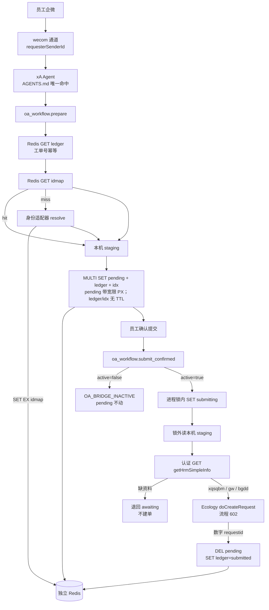
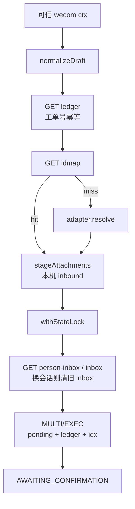
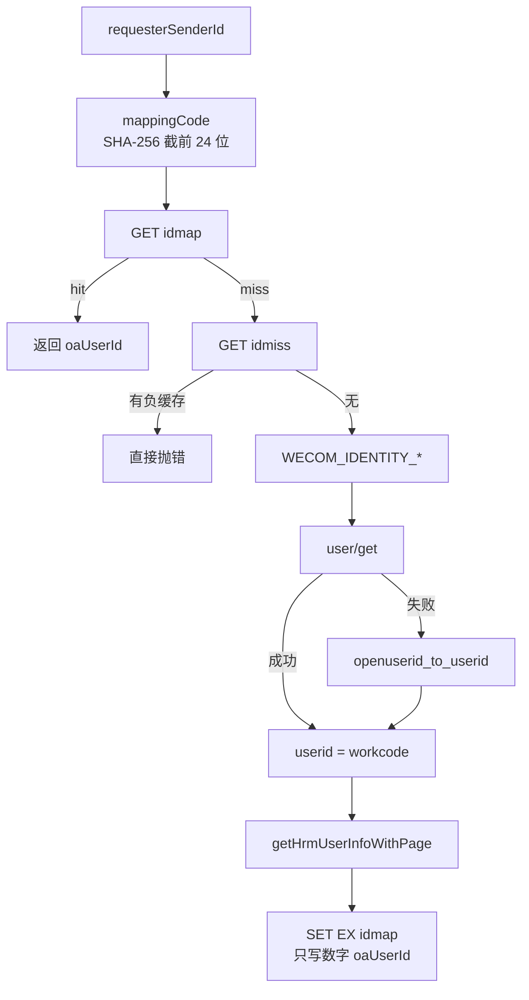
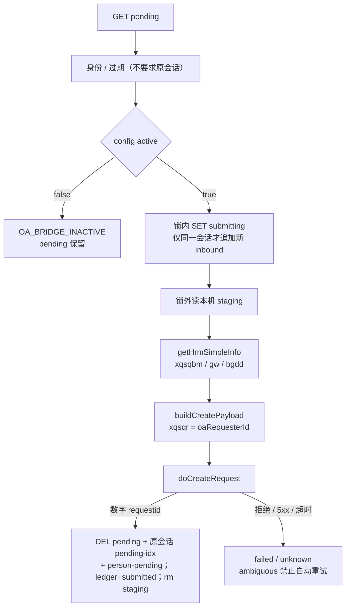

# OA 插件与 Redis 链路

适用对象：需要看清 **`oa-workflow-bridge-redis` 与独立 Redis 怎么串起来、每一步碰哪把 key** 的工程师。

部署命令、YAML、错误码、启停顺序仍以 [OA Workflow Bridge（Redis）接入手册.md](OA%20Workflow%20Bridge（Redis）接入手册.md) 为准。独立 Redis 怎么跑见 [../Redis 独立实例部署手册.md](../Redis%20独立实例部署手册.md)。全景 I/O 见 [../xA 现网加固与演进全景.md](../xA%20现网加固与演进全景.md)。身份转换步骤见 [身份适配器说明.md](身份适配器说明.md)。

**本文只讲：** OA 插件 × Redis 的节点顺序、谁读谁写、五个 action 碰到哪些 key。不重复 compose / 错误码全文。

阅读顺序见 [../README.md](../README.md)。

---

## 1. 这条链是什么

单 Gateway 点查链路。Agent 只整理 draft；插件做身份、确认态和建单；Redis 只存**这一张工单**的 key，不扫全库。

| 项 | 口径 |
| --- | --- |
| 宿主 | 单 Gateway；锁是进程内 `withStateLock` 队列，**不是** Redis `SET NX` |
| 连接 | `OA_REDIS_URL` → `REDIS_URL` → `bridge-config.json` 的 `redis.url`。容器内不要用 `127.0.0.1` |
| 前缀 | 默认 `oa-workflow-bridge`（不含插件 id 里的 `-redis`） |
| ledger / idx | `SET` **不带 EX** |
| pending | `SET PX` = JSON `expiresAt` + 60 秒宽限（兜底回收）；**过期判定只看 `expiresAt`** |
| idmap / idmiss | 适配器 `SET EX`；桥接对 `idmap` **只 GET** |
| 附件 | 本机 staging；base64 不进 Redis |
| 业务路径 | 只用 `GET` / `SET` / `DEL` + `MULTI`/`EXEC`；禁止 `SCAN` / `KEYS` |

生产 Redis：独立实例、AOF、`noeviction`。两个 Gateway 连同一 Redis 会双写 OA。

---

## 2. 主路径



身份失败、规则未唯一命中、资料现查失败、或 `active=false`，都**不会**调 `doCreateRequest`。身份失败时 pending 也不会写。资料失败时 pending 退回 awaiting。

员工可见成功口径：只有工具回执 `SUBMITTED` + 数字 `requestId`。

---

## 3. 关键节点 hop

| 序 | 节点 | 输入 | 输出 | Redis |
| --- | --- | --- | --- | --- |
| 1 | wecom 通道 | `from.userid`（`wo…` 加密串） | `ctx.requesterSenderId` | 不写 |
| 2 | xA | 员工文字 + 已注入 `AGENTS.md` | 唯一命中才 `prepare` | 不写 |
| 3 | `oa_workflow.prepare` | 可信 wecom ctx + draft | 身份未解析则停 | `GET ledger` 做工单号幂等 |
| 4 | 身份 / idmap | `mappingCode` = SHA-256(SenderId) 截前 24 位 | 1–18 位 `oaUserId`（建单 Header `userid` 与 `xqsqr`） | 桥接 **只 GET** `idmap` |
| 5 | 适配器（仅 miss） | 加密 SenderId | 写缓存后返回人员 id | **适配器** `SET EX idmap`；失败 `SET EX idmiss` |
| 6 | 本机 staging | 本轮 inbound / 工具 ctx 本地路径（模型不必传） | `storedName` / size | 附件内容不进 Redis |
| 7 | 待确认 | 上面全部成功 | `AWAITING_CONFIRMATION` + `confirmationId` | `MULTI`：`pending`（带宽限 `PX`）+ `ledger` + `idx` + `pending-idx` + `person-pending`；认领后 `DEL inbox` / `person-inbox` |
| 8 | `submit_confirmed` 闸门 | 原发送人 + `confirmationId`（跨会话也可；不并入新会话附件） | `active=false` 则 `OA_BRIDGE_INACTIVE`；否则锁内 `submitting` | `GET pending`；通过后 `SET submitting` |
| 9 | 提交前资料 | `pending.oaRequesterId` | `xqsqbm` / `gw` / `bgdd`。失败退回 awaiting | **不写 Redis**。认证 `GET getHrmSimpleInfo` |
| 10 | 建单 | 资料齐全 + staging | `SUBMITTED` + 数字 `requestId` | 成功 `DEL pending` + `DEL` 原会话 `pending-idx` + `DEL person-pending` + ledger=`submitted`。**不是 Redis 全空**，删留见 OA Redis 手册 3.3.1 |

建单 Header 的 `userid` 与表单 `xqsqr` 都是**聊天员工**人员 id（RSA 加密 Header，明文写 `xqsqr`）。明文 userid、工号、`wo…` 都不进 Redis。接口账号只用于换 token 与只读预检。

---

## 4. `prepare`

身份通过后才写 Redis。`prepare` **不调** `applytoken` / `doCreateRequest` / `getHrmSimpleInfo`。身份 miss 时适配器可能调企微与 `getHrmUserInfoWithPage`，那不是桥接 `oa-client.mjs`。



| 序 | 节点 | 做什么 | Redis |
| --- | --- | --- | --- |
| 1 | `requireTrustedContext` | `messageChannel=wecom` 且有 `requesterSenderId` / session | — |
| 2 | 插件生成内部幂等号 + `normalizeDraft` | `IT-YYYYMMDD-HHMMSS-XXXX`（忽略模型传入）；`systemName` 必须在 `ticket-type-systems.json` | — |
| 3 | `getLedger` | `submitted` / `submitting` / `unknown` / `awaiting` 分别拒绝 | `GET {prefix}:ledger:{工单号}` |
| 4 | `getMappedOaUserId` | 先 GET 缓存；miss 才 `resolve(senderId)`；未解析不写 pending | `GET {prefix}:idmap:{mappingCode}` |
| 5 | `stageAttachments` | 合并当前轮 hook 缓存、工具 ctx 媒体路径、可选模型 `attachments`；hook 与工具 ctx 会话键不对齐时按候选键读取（单聊 `sessionKey` 含发送人才回退裸键）；不刮完整 prompt / 历史消息；占位路径忽略；缺失文件跳过；**不扫描** inbound 目录；`realpath` 限制在 `media/inbound`；单文件 10MB / 合计 25MB / 最多 10 个。`NO_NEW_ATTACHMENT` 不清 hook 缓冲 | 不写附件内容 |
| 6 | `commitTicketState` | 同一工单号复用会 DEL 旧 idx 与旧 pending | `SET pending`（带宽限 `PX`）/ `ledger` / `idx`（无 EX） |

代码：`src/tool.mjs`（`prepare` 分支）、`src/state-store.mjs`、`src/attachments.mjs`。

---

## 5. 身份 miss

查找键是 **`mappingCode`**，不是工号、不是姓名。缓存命中：0 次外部 HTTP。桥接 `oa-client.mjs` **不**调企微、**不**调 `getHrmUserInfoWithPage`（用工号点查人员 id 只在适配器）。`submit_confirmed` 另走 `getHrmSimpleInfo`，见第 6 节与 [../xA 现网加固与演进全景.md](../xA%20现网加固与演进全景.md) 第 7 节。



| 序 | 节点 | 做什么 | Redis |
| --- | --- | --- | --- |
| 1 | `mappingCodeOf` | SHA-256(senderId) 小写十六进制截前 24 位 | 查找键 |
| 2 | `cache.getIdmap` | 命中直接返回 | `GET idmap`；值 `{ oaUserId, cachedAt }` |
| 3 | `cache.getIdmiss` | 近期失败码原样抛出，不打企微 / 人事 | `GET idmiss`；TTL 10 分钟 |
| 4 | credentials | 主进程必须有 `WECOM_IDENTITY_CORPID` / `SECRET` | — |
| 5 | `WecomClient.lookupUserid` | `user/get` 失败再 `batch/openuserid_to_userid` | — |
| 6 | `alignWorkcode` | 明文 userid 当 workcode；扩展属性「工号」若存在必须相等 | 明文 / 工号不落盘 |
| 7 | `OaHrmClient` | 只 POST `params.workcode`；取唯一数字 id | 成功 `SET EX idmap` 24h；失败 `SET EX idmiss` |

转换步骤与错误码只在 [身份适配器说明.md](身份适配器说明.md) 写全。HTTP **无重试**、超时与模型回执见该文档第 8.1 节。

---

## 6. `submit_confirmed`

锁内改状态，锁外读附件、调 OA。`active=false` 时 pending 不动。



| 序 | 节点 | 做什么 | Redis |
| --- | --- | --- | --- |
| 1 | `getPending` | 无 pending 时按 idx 读 ledger；已 submitted 返回 `ALREADY_SUBMITTED` | `GET pending`；必要时 `GET idx` → ledger |
| 2 | 校验 | 只核原发送人；过期则 `CONFIRMATION_EXPIRED`。不要求原 OpenClaw 会话 | 不改 key |
| 3 | `active` 闸门 | `false` → `OA_BRIDGE_INACTIVE`；可再确认 | 不写 submitting |
| 4 | `withStateLock` | 同进程串行；**同一会话**确认消息若带新 inbound，追加 staging（排除 prepare 已暂存路径）。跨会话不并入新图、不清当前会话 inbound | `SET pending.submissionState=submitting` |
| 5 | `encodeStagedAttachments` | staging 丢失 → `STAGING_MISSING`，退回 awaiting，**不调 OA** | 锁外执行 |
| 6 | `lookupRequesterProfile` | 认证 `GET getHrmSimpleInfo?userid=`（token + RSA 申请人）；`002` / 网络 → `OA_PROFILE_LOOKUP_FAILED`；缺部门 / 岗位 / 地点 → `OA_PROFILE_INCOMPLETE`。退回 awaiting，**不调建单**。`clry` 另按 `system-handlers.json` 写入 | 锁外执行；不写 Redis |
| 7 | `OAClient.createRequest` | Header：token + appid + RSA(申请人)；表单 `xqsqr` + `xqsqbm` / `gw` / `bgdd` + `clry` | 成功：`DEL pending` + `DEL` 原会话 `pending-idx` + `DEL person-pending`，`ledger=submitted`。**明确拒绝**：同样三把 DEL，`ledger=failed`。**结果不明**：pending 留 `submissionState=unknown`。删留见 OA Redis 手册 3.3.1 |

`status` / `cancel` 的 Redis 操作见第 7 节。错误码全文见 OA Redis 手册第 7 节。

---

## 7. Redis 键与五个 action

默认前缀：`oa-workflow-bridge`。多环境改 `bridge-config.json` → `redis.keyPrefix`。

| Key | 值 | TTL | 谁写 |
| --- | --- | --- | --- |
| `{prefix}:pending:{confirmationId}` | 待确认 JSON | `SET PX` = JSON `expiresAt` + 60 秒宽限；过期判定看 `expiresAt`（默认 24h） | 桥接 SET / DEL |
| `{prefix}:ledger:{externalTicketId}` | 幂等台账 JSON | 永久 | 桥接 SET |
| `{prefix}:idx:confirmation:{confirmationId}` | 工单号字符串 | 随 confirmation 生命周期 | 桥接 SET / DEL 旧 idx |
| `{prefix}:pending-idx:{identity}:{session}` | 该人该会话当前的 `confirmationId` | 同 pending 的 `SET PX` | 桥接 SET / DEL |
| `{prefix}:person-pending:{identity}` | 该人**全局**当前待确认 `confirmationId` | 同 pending 的 `SET PX` | 桥接 SET / DEL |
| `{prefix}:person-tickets:{identity}` | 最近状态摘要（最多 20 条） | 无 TTL | 桥接 SET |
| `{prefix}:inbox:{identity}:{session}` | 建单前 `attach` 的附件清单 JSON | `SET PX` = `inboxTtlMinutes`（默认 30） | 桥接 SET / DEL |
| `{prefix}:person-inbox:{identity}` | 该人当前 inbox 的 session 码 | 与 inbox 同一套 `SET PX` | 桥接 SET / DEL |
| `{prefix}:idmap:{mappingCode}` | `{ oaUserId, cachedAt }` | `SET EX`，默认 24h | **适配器写，桥接只 GET** |
| `{prefix}:idmiss:{mappingCode}` | 短错误码 | `SET EX`，默认 10 分钟 | 仅适配器 |

ledger 按内部工单号点查：防同一号再打 OA，不是按人冷却。防什么见 OA Redis 手册 **3.3**。同一人全局一张待确认是 `person-pending`。

| action | Redis 操作（只碰这一张工单） |
| --- | --- |
| `prepare` | `GET ledger` 做工单号幂等 → `GET person-pending`（本人全局已有别的待确认单则 `ALREADY_PENDING`）→ `GET idmap`（miss 走适配器）→ 若 `person-inbox` 指向别的 session 则先清旧 inbox → `GET inbox` 认领附件 → `MULTI` `SET pending` + `ledger` + `idx` + `pending-idx` + `person-pending` → `DEL inbox` / `person-inbox`；复用工单号则 `DEL` 旧 idx / pending |
| `attach` | 带 `confirmationId`：`GET pending` → 校验身份；**另一会话**已有此人待确认则 `ALREADY_PENDING`。同一会话则 `SET pending`（追加 `staged`）。不带：若另一会话已有 pending 则同样 `ALREADY_PENDING`；否则若 `person-inbox` 指向别的 session 则先清旧 inbox，再 `GET inbox` → `SET inbox` + `SET person-inbox`。**不碰** ledger |
| `status` | 无 ID：`GET person-pending` + `person-tickets` → 可确认则 `PERSON_STATUS`；`unknown`/`submitting` 顶层 `RECONCILIATION_REQUIRED`。有 ID：`GET pending`（只核身份）；没有则 `GET idx` → `GET ledger` |
| `cancel` | `GET pending` → `MULTI` `DEL pending` + `DEL` 原会话 `pending-idx` + `DEL person-pending` + `SET ledger=cancelled`（idx 保留） |
| `submit_confirmed` | `GET pending` → 校验原发送人/过期（不要求原会话）→ `active=false` 则停 → 否则锁内仅同一会话追加新 inbound 并 `SET submitting` → 锁外读 staging、**认证 GET `getHrmSimpleInfo`（不写 Redis）** → `doCreateRequest` → 成功 `DEL pending` + `DEL` 原会话 `pending-idx` + `DEL person-pending` |

`pending-idx` 的键必须带 `identity`：群聊里多人分别建单时，只按会话建索引会互相顶掉。**同一人跨 `/new` 的闸门是 `person-pending`**，不是 `pending-idx`。

`status` **优先读 pending**：身份匹配即可（不要求原会话），未过期且非 `submitting`/`unknown` 才返回 `AWAITING_CONFIRMATION`；过期返回 `CONFIRMATION_EXPIRED`；`submitting`/`unknown` 返回 `RECONCILIATION_REQUIRED`。无 ID 时：可确认的待确认才是 `PERSON_STATUS`；对账中顶层同样是 `RECONCILIATION_REQUIRED`。pending 已不在、只剩 ledger 时，回执 `code` 收成 `CONFIRMATION_EXPIRED` / `CANCELLED` / `ALREADY_SUBMITTED` 等，不把 ledger 小写 `status` 直接回给模型（见 OA Redis 手册 **7.5.2**）。失败中文见 **7.5**。

---

## 8. 连接怎么进插件

```text
~/xa-redis（独立 compose，AOF + noeviction）
        │  主机名 xa-redis:6379
        ▼
entrypoint export OA_REDIS_URL
        ▼
src/redis-client.mjs  createClient({ url, database })
        ├── 桥接 state-store：pending / pending-idx / person-pending（SET PX 宽限）、inbox / person-inbox（SET PX，默认 30 分钟）、ledger / idx / person-tickets（SET 不带 EX）
        └── 适配器 cache.mjs：idmap / idmiss（SET EX）
```

- `src/redis-client.mjs`：`OA_REDIS_URL` 优先；`connect` 后把 client 交给 state-store。
- 桥接 `commitTicketState`：`multi().set/del.exec()`。
- 适配器 `src/cache.mjs`：node-redis `set(key, value, { EX })`。
- 预检 `scripts/readonly-preflight.mjs`：只 `PING` + `getCreateWorkflowList`，不写 pending。

密码分边、compose YAML 只在 Redis 手册与 OA Redis 手册 5.5 写全。

---

## 9. 相关文档

| 文档 | 内容 |
| --- | --- |
| [../xA 现网加固与演进全景.md](../xA%20现网加固与演进全景.md) | 全景：哪些进 OA / 不进、各层 I/O；**第 7 节两条人事 HTTP** |
| [OA Workflow Bridge（Redis）接入手册.md](OA%20Workflow%20Bridge（Redis）接入手册.md) | 部署、工具契约、错误码、Key 生命周期；**3.3.1 `SUBMITTED` 后删留** |
| [../Redis 独立实例部署手册.md](../Redis%20独立实例部署手册.md) | 独立 Redis、AOF、密码分边 |
| [身份适配器说明.md](身份适配器说明.md) | miss 路径、凭据注入、会话 jsonl |
| [企微到OA身份与数据流.md](企微到OA身份与数据流.md) | appid / 调用者 / 申请人、通道字段 |
| [工单会话隔离与资料回收场景.md](工单会话隔离与资料回收场景.md) | 同一人跨会话只能确认/取消；`person-pending` 闸门 |
| [Ecology 流程创建 API 说明.md](Ecology%20流程创建%20API%20说明.md) | applytoken / doCreateRequest |
