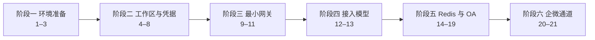

# OpenClaw Gateway Linux 服务器安装手册

在 **SmartX 超融合划出的 Linux 虚机**（或同等内网 Linux 服务器）上安装 **Docker Engine**，把 Aidy OpenClaw Gateway 跑在 Linux 容器里。

**快捷跳转：** [目录](#toc) · [安装链路](#install-chain) · [检查清单](#sec-23) · [常见问题](#sec-24)

<a id="toc" name="toc"></a>

## 目录

点击条目即可跳转到对应章节；各章末尾可返回目录或进入上一节 / 下一节。

- [概述](#overview)
  - [适用对象与边界](#audience)
  - [凭据规则](#credential-rules)
  - [专题文档对照](#related-docs)
  - [默认约定](#defaults)
  - [路径约定](#paths)
- [安装链路总览](#install-chain)
  - [必须提前或插入的六处](#must-insert)
  - [openclaw.json 随链路演进](#json-evolution)
  - [每次 up 后的基线检查](#baseline-check)
- [阶段一：环境准备](#phase-1)
  - [1. 服务器准备](#sec-01)
  - [2. 安装 Docker Engine 与 Compose](#sec-02)
  - [3. Docker 开机自启、加速、验证](#sec-03)
- [阶段二：工作区与凭据](#phase-2)
  - [4. 创建工作目录并铺工作区](#sec-04)
    - [4.1 把本仓库拷到服务器](#sec-04-1)
    - [4.2 建目录并拷工作区规则](#sec-04-2)
  - [5. 目录授权](#sec-05)
  - [6. 配置全部凭据](#sec-06)
    - [6.1 变量契约](#sec-06-1)
  - [7. 配置 entrypoint.sh](#sec-07)
  - [8. 配置 docker-compose.yml](#sec-08)
- [阶段三：最小网关](#phase-3)
  - [9. 最小 openclaw.json（仅网关）](#sec-09)
  - [10. 拉取 OpenClaw 镜像](#sec-10)
  - [11. 第一次 up：检查健康状态并查日志](#sec-11)
    - [Dashboard 与网络](#sec-11-dashboard)
- [阶段四：接入模型](#phase-4)
  - [12. 把模型写入 openclaw.json](#sec-12)
  - [13. 第二次 up：检查健康状态并查日志](#sec-13)
- [阶段五：Redis 与 OA 插件](#phase-5)
  - [14. 安装独立 Redis 实例](#sec-14)
    - [14.1–14.3 密码、compose、启动](#sec-14-1)
  - [15. 拷贝 OA 自定义插件](#sec-15)
  - [16. 安装 OA 插件依赖](#sec-16)
  - [17. 把 OA 配进 openclaw 并启用](#sec-17)
  - [18. 配置 Gateway 共享网络](#sec-18)
  - [19. 第三次 up：检查健康状态并查日志](#sec-19)
- [阶段六：企微通道](#phase-6)
  - [20. 安装企微公共插件](#sec-20)
    - [20.1 先写入 allow / entries](#sec-20-1)
    - [20.2 安装插件](#sec-20-2)
    - [20.3 验证已安装](#sec-20-3)
  - [21. 用命令把企微配进 openclaw 并启用（终态）](#sec-21)
    - [21.1 终态 openclaw.json](#sec-21-1)
- [附录：运维、验收与排障](#appendix)
  - [22. 日常运维](#sec-22)
  - [23. 检查清单](#sec-23)
  - [24. 常见问题](#sec-24)
  - [25. 安全注意](#sec-25)
  - [26. 容量扩展](#sec-26)

---

<a id="overview" name="overview"></a>

## 概述

本文按一条安装链路写成 **彼此独立的模块**。每一章自带：目标、自检命令、完整步骤、成功标准。缺目录或文件时，用该章开头的补救命令当场补齐。

现网宿主边界（虚机 vs 集群）见 [Aidy 现网加固与演进全景.md](Aidy%20现网加固与演进全景.md) 第 4 节。

本手册只写 **Linux 服务器上按顺序把网关装起来**。字段词典、生产加固、插件契约放到专题文档；安装时不要改专题里的命令。

<a id="audience" name="audience"></a>

### 适用对象与边界

- **做：** 在 SmartX 超融合划出的 Linux 虚机（或同等内网 Linux）里装 Docker Engine，用容器跑 Aidy OpenClaw Gateway。
- **不做：** 登录 SmartX 控制台或宿主机节点装 Gateway；也不在本机执行 Windows 原生路径里的 PowerShell / DPAPI / 外部密钥脚本。

<a id="credential-rules" name="credential-rules"></a>

### 凭据规则

Gateway Token、企微 Bot、模型 API Key、`baseUrl` 等全部走 Docker Compose secrets（文件挂到 `/run/secrets/`），由 `entrypoint.sh` `export` 成环境变量。

- `openclaw.json` 只写 `${VAR}`，不写明文。
- 不要在 compose 的 `environment:`、`.env` 里写第三方真值。
- 不要使用 `env_file: .env`。

<a id="related-docs" name="related-docs"></a>

### 专题文档对照

| 主题 | 本手册做什么 | 细节在哪 |
| --- | --- | --- |
| 变量名 / `${VAR}` | [第 6 节](#sec-06)一次写齐 secrets | 字段含义见 [openclaw.json 配置参考.md](openclaw.json%20配置参考.md)；以后迁配置中心见 [第三方凭据注入与配置中心演进.md](第三方凭据注入与配置中心演进.md) |
| 百炼模型字段 | [第 12 节](#sec-12)写入可启动的 catalog | [DashScope 兼容 Provider 配置手册.md](DashScope%20兼容%20Provider%20配置手册.md) |
| 独立 Redis 生产加固 / 云实例 | [第 14 节](#sec-14)只起本机 `~/aidy-redis` | [Redis 独立实例部署手册.md](Redis%20独立实例部署手册.md) |
| OA 工具契约 / `bridge-config` / 错误码 | [第 15–19 节](#sec-15)只把插件装上并连上 Redis | [OA_tool/OA Workflow Bridge（Redis）接入手册.md](OA_tool/OA%20Workflow%20Bridge（Redis）接入手册.md) |
| 企微 catalog 钉死 /「思考中」 | [第 20–21 节](#sec-20)用命令装上并启用 | [WeCom 通道插件接入手册.md](WeCom%20通道插件接入手册.md) |
| 装完之后的巡检、备份、升级 | [第 22 节](#sec-22)只给日常启停 | [OpenClaw Gateway Docker 运维手册.md](OpenClaw%20Gateway%20Docker%20运维手册.md) |

<a id="defaults" name="defaults"></a>

### 默认约定

| 项 | 值 |
| --- | --- |
| 发行版 | Ubuntu 24.04 LTS（22.04 亦可；RHEL / CentOS 需自行换 Docker 安装源，本手册不覆盖） |
| 现网宿主 | SmartX 超融合上的 Linux 虚机。本手册步骤都在这台虚机的 Linux 里做，不要登录 SmartX 控制台装 Gateway |
| 宿主机工作目录 | `~/aidy`（虚机本机 Linux 文件系统，不要放 NFS/CIFS，也不要放到超融合共享盘） |
| 容器内用户 | `node`，uid `1000`，家目录 `/home/node` |
| 镜像 | `openclaw/openclaw:latest`（Docker Hub）。若只能从 GHCR 拉取，拉完必须 `docker tag` 成这个名字，或后续凡写镜像名的地方一律改用 GHCR 名 |
| 网关端口 | 宿主 `18789` → 容器 `18789`。不要对公网开放 |
| OA 建单 | 初装只加载插件，`bridge-config.json` 保持 `active=false` |
| 文中占位 | `YOUR_LINUX_USER` = SSH 用户名；`SERVER` = 主机名或内网 IP |

<a id="paths" name="paths"></a>

### 路径约定

路径不要混：

| 谁看到 | 路径 | 写在哪里 |
| --- | --- | --- |
| Linux 宿主机 | `/home/YOUR_LINUX_USER/aidy/...` | `docker-compose.yml` 的 `volumes:` **左边**（推荐写相对路径 `./config`） |
| 容器里的 OpenClaw | `/home/node/.openclaw/...` | `openclaw.json` |

```text
宿主机 ~/aidy/config        →  容器 /home/node/.openclaw
宿主机 ~/aidy/workspace     →  容器 /home/node/.openclaw/workspace
宿主机 ~/aidy/extensions    →  容器 /home/node/.openclaw/extensions
宿主机 ~/aidy/entrypoint.sh →  容器 /entrypoint.sh（只读）
宿主机 ~/aidy/secrets/*.txt →  容器 /run/secrets/<名字>
```

`openclaw.json` 必须写 `/home/node/.openclaw/...`。宿主机不必创建名为 `node` 的用户。

---

<a id="install-chain" name="install-chain"></a>

## 安装链路总览

主链是 **先起一个能健康响应的网关，再按层叠加模型 → Redis → OA 自定义插件 → 企微公共插件**。每一层 `up` 之后立刻查健康和日志，不要攒到最后一次验收。



按这个顺序做（点击可跳转）：

1. [服务器准备](#sec-01)（系统 / 时区 / 防火墙）
2. [安装 Docker Engine 与 Compose](#sec-02)
3. [Docker 开机自启、加速、hello-world](#sec-03)
4. [创建目录 + 铺工作区规则](#sec-04)（此时不拷插件）
5. [目录授权](#sec-05)（uid 1000）
6. [配置全部凭据](#sec-06)（secrets，一次写齐）
7. [配置 entrypoint.sh](#sec-07) ← **必须**：secrets 不会自动变成环境变量
8. [配置 docker-compose.yml](#sec-08)（第一份：无 Redis 网络）
9. [最小 openclaw.json](#sec-09)（仅 gateway；无模型、无插件、无 channels）
10. [docker pull](#sec-10)
11. [第一次 up → 健康检查 + 日志](#sec-11) ← 只证明容器 / 端口 / Token 通
12. [模型写入 openclaw.json](#sec-12)
13. [第二次 up → 健康检查 + 日志](#sec-13) ← models status 不再 unresolved
14. [独立 Redis 实例](#sec-14)（创建网络 aidy-shared）
15. [拷贝 OA 自定义插件](#sec-15)
16. [安装 OA 插件 npm 依赖](#sec-16) ← **必须**在 pull 之后；用官方镜像里的 Node
17. [把 OA 配进 openclaw 并启用](#sec-17) ← 只改 json，禁止 up
18. [升级 compose 共享网络 + entrypoint 拼 OA_REDIS_URL](#sec-18)
19. [第三次 up → 健康检查 + 日志](#sec-19) ← 日志无 EAI_AGAIN aidy-redis
20. [安装企微公共插件](#sec-20)
21. [用命令配进 openclaw 并启用 → 核对终态 json](#sec-21)

相对「创建 → 授权 → 凭据 → yml → pull → up → 模型 → up → Redis → 拷 OA → 装 OA → 启用 OA → 共享网络 → up → 装企微 → 启用企微」，有六处必须插入或必须提前：

<a id="must-insert" name="must-insert"></a>

### 必须提前或插入的六处

1. **服务器 / Docker 必须在创建目录之前。** 没有 dockerd 谈不上 pull / up。
2. **必须有 `entrypoint.sh`。** OpenClaw 不读 `*_FILE` 这类变量；secret 文件要先 `export` 成 `${VAR}` 对应的环境变量。
3. **第一次 `up` 之前必须有一份最小 `openclaw.json`。** 至少含 `gateway.auth.token`。不要在这一份里写 `plugins` / `channels.wecom` / 模型 catalog。
4. **`docker pull` 必须在「安装 OA 依赖」之前。** `npm install` 用的是 `docker run ... openclaw/openclaw:latest npm install`，镜像不在本机就会去 Docker Hub 再拉一次，或直接失败。
5. **启用 OA 插件之后、第三次 `up` 之前，必须先起独立 Redis，并把 Gateway 的 compose 加入同一 Docker 网络。** 插件一加载就会解析 `aidy-redis`，未接线会刷 `EAI_AGAIN`。不要把 Redis 写进 `~/aidy/docker-compose.yml`。
6. **写 `channels.wecom` 之前必须先把公共插件装上并 enabled。** 通道 id 由插件注册；插件未装时写 `channels.wecom` 会 `unknown channel id`，容器 Restarting。

<a id="json-evolution" name="json-evolution"></a>

### openclaw.json 随链路演进

第 9 / 12 节给出**当时完整文件**（最小网关 → 含模型）。第 17 节只追加 OA 插件字段（对照 `openclaw/openclaw.json` 的 `plugins` / `tools`）。企微用容器内命令写入，最后用 [第 21.1 节](#sec-21-1) 对照仓库样例核对，不再在本手册贴整份终态 JSON。

| 章 | 这一份有什么 |
| --- | --- |
| [9](#sec-09) | 仅 `gateway`（+ `skipBootstrap`）。无模型、无 `plugins`、无 `channels`、无 `bindings` |
| [12](#sec-12) | 第 9 份 + 模型 catalog + session + agents + tools |
| [17](#sec-17) | 第 12 份 + OA 插件 |
| [21](#sec-21) | 终态：第 17 份 + 企微 `allow` / `entries` + `channels.wecom` + `bindings` |

<a id="baseline-check" name="baseline-check"></a>

### 每次 up 后的基线检查

每次 `up` 之后都先跑这三行（各章再加本阶段附加项）：

```bash
cd ~/aidy
docker compose ps
docker logs --tail 80 aidy-gateway
curl -sS http://127.0.0.1:18789/healthz
```

改了 `secrets/*.txt`、entrypoint、compose 挂载、`plugins.load.paths` 或网络时，必须 `docker compose down && docker compose up -d`，只 `restart` 不够。

---

<a id="phase-1" name="phase-1"></a>

> **阶段一 · 环境准备（第 1–3 节）**  
> 先把 Linux 虚机和 Docker 准备好。没有 dockerd，后面的 pull / up 都做不了。

<a id="sec-01" name="sec-01"></a>

## 1. 服务器准备

> **目标：** SSH 能登录、系统够用、时区正确、18789 未对公网开放。

现网宿主是 SmartX 超融合划出的 **Linux 虚机**，不是集群本身。本模块及后文所有命令都在这台虚机里执行。

| 谁 | 管什么 |
| --- | --- |
| 平台运维（SmartX） | 虚机规格（CPU / 内存 / 磁盘）、存储、VLAN / 出网、快照 |
| 本系统 | 虚机内的 Linux、Docker、`~/aidy`、Redis、Gateway |

不要把 Gateway 装进 SmartX 控制台或宿主机节点。内存或磁盘不够找平台扩虚机，不要用 compose `mem_limit` 代替。`~/aidy` 必须在虚机本机盘上。出网（拉镜像、百炼、企微、OA）由平台网络策略决定。

用 **SSH** 登录，账号须能 `sudo`。只用 Docker Engine，不要装桌面环境来跑 Gateway。

```bash
. /etc/os-release && echo "$PRETTY_NAME"
ps -p 1 -o comm=
uname -m
free -h
df -h /
timedatectl
id -u
getent passwd 1000
```

| 项 | 期望 |
| --- | --- |
| 发行版 | Ubuntu 24.04 或 22.04 |
| PID 1 | `systemd`（不是 `init`） |
| 架构 | `x86_64`（本手册按 amd64；ARM 须自行换镜像架构） |
| 内存 / 磁盘 | 建议 ≥ 4GB 内存、系统盘留 ≥ 20GB |
| uid 1000 | 有对应账号即可；**没有也不必新建 `node` 用户** |

时区建议与业务一致：

```bash
sudo timedatectl set-timezone Asia/Shanghai
timedatectl status
```

18789 带 Gateway Token，**不要对公网开放**。SSH 必须先放行，避免锁死自己：

```bash
sudo ufw allow OpenSSH
sudo ufw status
```

先不要 `ufw allow 18789`。云主机安全组：入站 18789 默认拒绝。网关起来后若必须内网直连 Dashboard，只按源网段放行，例如：

```bash
sudo ufw allow from 10.0.0.0/8 to any port 18789 proto tcp
sudo ufw enable
```

不要对 `0.0.0.0/0` 开放 18789。

> **成功标准：** 上表各项满足；`ufw status` 已放行 OpenSSH；18789 未对 `0.0.0.0/0` 开放。

[↑ 目录](#toc) · [下一节 → 2. 安装 Docker Engine 与 Compose](#sec-02)

---

<a id="sec-02" name="sec-02"></a>

## 2. 安装 Docker Engine 与 Compose

> **目标：** 当前用户能无 sudo 使用 `docker` 与 `docker compose`。

**自检：**

```bash
command -v docker && docker compose version
```

已有输出且 `groups` 含 `docker` 可跳过安装，仍须确认不要用 `sudo docker` 作为长期习惯。

官方仓库安装：

```bash
sudo apt-get update
sudo apt-get install -y ca-certificates curl
sudo install -m 0755 -d /etc/apt/keyrings
sudo curl -fsSL https://download.docker.com/linux/ubuntu/gpg -o /etc/apt/keyrings/docker.asc
sudo chmod a+r /etc/apt/keyrings/docker.asc
echo "deb [arch=$(dpkg --print-architecture) signed-by=/etc/apt/keyrings/docker.asc] https://download.docker.com/linux/ubuntu $(. /etc/os-release && echo $VERSION_CODENAME) stable" | sudo tee /etc/apt/sources.list.d/docker.list
sudo apt-get update
sudo apt-get install -y docker-ce docker-ce-cli containerd.io docker-buildx-plugin docker-compose-plugin
sudo usermod -aG docker $USER
```

**退出 SSH 再登录一次**（docker 组才生效）。当前会话也可 `newgrp docker`。然后：

```bash
groups
docker version
docker compose version
```

不要：`sudo apt install npm`、不要在宿主装 Node。插件依赖一律用官方 OpenClaw 镜像里的 Node 安装。

> **成功标准：** `groups` 含 `docker`；`docker version` 与 `docker compose version` 都有输出。

[← 1. 服务器准备](#sec-01) · [↑ 目录](#toc) · [下一节 → 3. Docker 开机自启、加速、验证](#sec-03)

---

<a id="sec-03" name="sec-03"></a>

## 3. Docker 开机自启、加速、验证

> **目标：** dockerd 开机自启；本机能跑容器。

```bash
sudo systemctl enable --now docker
systemctl is-active docker
```

应输出 `active`。

`registry-mirrors` **只加速 Docker Hub（docker.io）**，不加速 `ghcr.io`。本指南默认镜像名是 `openclaw/openclaw:latest`。

```bash
sudo mkdir -p /etc/docker
sudo tee /etc/docker/daemon.json >/dev/null <<'EOF'
{
  "registry-mirrors": ["https://docker.xuanyuan.me"]
}
EOF
sudo systemctl restart docker
```

免费加速源可能失效，以当时能用的源为准。公司出口必须走 HTTP 代理时，给 dockerd 配代理后再拉镜像：

```bash
sudo mkdir -p /etc/systemd/system/docker.service.d
sudo tee /etc/systemd/system/docker.service.d/http-proxy.conf >/dev/null <<'EOF'
[Service]
Environment="HTTP_PROXY=http://proxy.internal:8080"
Environment="HTTPS_PROXY=http://proxy.internal:8080"
Environment="NO_PROXY=localhost,127.0.0.1"
EOF
sudo systemctl daemon-reload
sudo systemctl restart docker
```

把 `proxy.internal:8080` 换成实际代理。

```bash
docker info | grep -A2 "Registry Mirrors"
docker run --rm hello-world
```

> **成功标准：** `systemctl is-active docker` 为 `active`；看到 `Hello from Docker!`。不要再单独起一套空白 OpenClaw。

[← 2. 安装 Docker Engine 与 Compose](#sec-02) · [↑ 目录](#toc) · [下一节 → 4. 创建工作目录并铺工作区](#sec-04)

---

<a id="phase-2" name="phase-2"></a>

> **阶段二 · 工作区与凭据（第 4–8 节）**  
> 铺目录、授权、一次写齐 secrets，再写 entrypoint 和第一份 compose。此时还不启动网关。

<a id="sec-04" name="sec-04"></a>

## 4. 创建工作目录并铺工作区

> **目标：** `~/aidy` 目录树就绪；工作区规则与 `MEMORY.md` 就位。**本模块不拷任何插件。**

必须放在 Linux 本机盘（家目录或专用数据盘再软链到 `~/aidy`）。不要放 NFS/CIFS。

<a id="sec-04-1" name="sec-04-1"></a>

### 4.1 把本仓库拷到服务器

在**源机器**上执行（用户名、IP、路径按实际改）。只需拷**这一份**仓库，不要再另拷 Windows 原生交接包。

```bash
ssh YOUR_LINUX_USER@SERVER 'mkdir -p ~/handoff'
scp -r /path/to/openclaw/linux YOUR_LINUX_USER@SERVER:~/handoff/aidy
```

或：

```bash
rsync -avz /path/to/openclaw/linux/ YOUR_LINUX_USER@SERVER:~/handoff/aidy/
```

Windows 源机器可用 WinSCP，或 PowerShell 里的 OpenSSH `scp`。不要用 SMB/NFS 把仓库直接挂成运行目录。`~/handoff/aidy` 就是本仓库根目录（内含 `openclaw/`、`OA_tool/`、`docker/`）。

<a id="sec-04-2" name="sec-04-2"></a>

### 4.2 建目录并拷工作区规则

在**服务器**上执行：

```bash
mkdir -p ~/aidy/{config,workspace,extensions,secrets}
chmod 700 ~/aidy/secrets

REPO="$HOME/handoff/aidy"

cp -r "$REPO/openclaw/workspace-rules/." ~/aidy/workspace/
cp "$REPO/openclaw/MAPPING_RULES.md" "$REPO/openclaw/ROUTING_RULES.md" \
   "$REPO/openclaw/REGION_MAPPING.md" "$REPO/openclaw/TICKET_SCHEMA.md" \
   "$REPO/openclaw/TICKET_STATUS_BANNER.md" "$REPO/openclaw/OA_WORKFLOW_CONTRACT.md" \
   ~/aidy/workspace/

test -f ~/aidy/workspace/MEMORY.md || printf '%s\n' '# MEMORY' > ~/aidy/workspace/MEMORY.md
ls -la ~/aidy/config ~/aidy/workspace ~/aidy/extensions ~/aidy/secrets
```

工作区根目录必须有 `MEMORY.md`。没有的话，群聊寒暄时 Agent 会 `read` 失败再跑第二轮模型。为何必须有，见 [DashScope 兼容 Provider 配置手册.md](DashScope%20兼容%20Provider%20配置手册.md) §2.5。

本模块不要：

- 拷 `oa-workflow-bridge-redis` / `wecom-oa-identity-adapter` / `wecom-openclaw-plugin`
- 写 `openclaw.json` / secrets / compose
- `npm install`
- 对整棵 `~/aidy` 做总 `chown`（下一章才授权）

> **成功标准：** 四个子目录存在；`~/aidy/secrets` 权限 `700`；`~/aidy/workspace/MEMORY.md` 存在；`extensions/` 此时可以是空的。

[← 3. Docker 开机自启、加速、验证](#sec-03) · [↑ 目录](#toc) · [下一节 → 5. 目录授权](#sec-05)

---

<a id="sec-05" name="sec-05"></a>

## 5. 目录授权

> **目标：** 让容器内 uid `1000`（镜像用户 `node`）能读写 `~/aidy`。

compose 将写 `user: "1000:1000"`。绑定挂载后，宿主机 `~/aidy` 和容器 `/home/node/.openclaw` 是同一批文件。宿主机**不必**创建名为 `node` 的用户，`chown 1000:1000` 只改数字 uid。

**自检：**

```bash
test -d ~/aidy && test -d ~/aidy/secrets
id -u
getent passwd 1000
```

若 `~/aidy` 不存在：

```bash
mkdir -p ~/aidy/{config,workspace,extensions,secrets}
chmod 700 ~/aidy/secrets
```

- **`id -u` 是 `1000`：** 收口几乎是空操作，你仍可直接编辑 `~/aidy`。仍然要跑，避免个别文件属主是 root。
- **`id -u` 不是 `1000`：** 本模块收口之后，不能再无 sudo 往 `~/aidy` 写文件。后面各章用 `sudo tee` / `sudo -e` 写入，写完再对本模块命令跑一遍。不要 `chmod 777`。

```bash
sudo chown -R 1000:1000 ~/aidy
chmod 700 ~/aidy/secrets
```

核对（看数字 uid，不要看登录用户名）：

```bash
ls -ln ~/aidy
stat -c '%u:%g %a %n' ~/aidy ~/aidy/config ~/aidy/workspace ~/aidy/extensions ~/aidy/secrets
df -T ~/aidy
```

| 路径 | 属主 | 权限 |
| --- | --- | --- |
| `~/aidy` 以及 `config` / `workspace` / `extensions` | `1000:1000` | 目录一般为 `755` |
| `~/aidy/secrets/` | `1000:1000` | `700` |

`ls -ln` 第三、四列应是 `1000 1000`。`df -T` 应是 `ext4` / `xfs` 等本机文件系统，不要 `nfs` / `cifs`。

之后任何一章用 SSH 用户新建了文件，对该章涉及的路径再执行一次：

```bash
sudo chown -R 1000:1000 ~/aidy
chmod 700 ~/aidy/secrets
chmod 600 ~/aidy/secrets/*.txt 2>/dev/null || true
```

> **成功标准：** `stat` 为 `1000:1000`；secrets 目录 `700`；文件系统不是 NFS/CIFS。

[← 4. 创建工作目录并铺工作区](#sec-04) · [↑ 目录](#toc) · [下一节 → 6. 配置全部凭据](#sec-06)

---

<a id="sec-06" name="sec-06"></a>

## 6. 配置全部凭据

> **目标：** 8 个 secret 文件一次写齐。后面的 entrypoint、compose、`openclaw.json` 都按这一套变量工作。企微真值现在就可以写入；通道尚未启用时，这些变量只是被 entrypoint export，不影响先把网关拉起来。Redis 密码是第 14 节才有的第 9 个文件，不要提前写。

**自检：**

```bash
test -d ~/aidy/secrets || mkdir -p ~/aidy/secrets
chmod 700 ~/aidy/secrets
```

OpenClaw 通过 `${VAR_NAME}` 引用环境变量（仅大写 `[A-Z_][A-Z0-9_]*`）。**禁止**在 `openclaw.json`、compose 的 `environment:`、`.env` 中写第三方真值。不要使用 `env_file: .env`。

<a id="sec-06-1" name="sec-06-1"></a>

### 6.1 变量契约

| 参数 | 环境变量 | secret 文件 | `openclaw.json` 占位 |
| --- | --- | --- | --- |
| Gateway Token | `OPENCLAW_GATEWAY_TOKEN` | `gateway_token.txt` | `${OPENCLAW_GATEWAY_TOKEN}` |
| 企微 BotId | `AIDY_IT_WECOM_BOT_ID` | `wecom_bot_id.txt` | `${AIDY_IT_WECOM_BOT_ID}` |
| 企微 BotSecret | `AIDY_IT_WECOM_BOT_SECRET` | `wecom_bot_secret.txt` | `${AIDY_IT_WECOM_BOT_SECRET}` |
| 模型 API Key | `AIDY_DOMESTIC_API_KEY` | `model_api_key.txt` | `${AIDY_DOMESTIC_API_KEY}` |
| 模型 Base URL | `AIDY_DOMESTIC_BASE_URL` | `model_base_url.txt` | `${AIDY_DOMESTIC_BASE_URL}` |
| 模型 ID（API 请求体） | `AIDY_DOMESTIC_MODEL_ID` | `model_id.txt` | `${AIDY_DOMESTIC_MODEL_ID}` |
| 完整模型 ref | `AIDY_DOMESTIC_MODEL_REF` | `model_ref.txt` | `${AIDY_DOMESTIC_MODEL_REF}`，内容如 `bailian/qwen3.8-max` |
| API 协议 | （json 写死） | `model_api.txt`（可留，entrypoint 仍 export） | json 写 `"openai-completions"`，不引用 `${AIDY_DOMESTIC_API}` |

`model_ref.txt` = `bailian/` + `model_id.txt` 的值。Provider 键名是 `bailian`，不要写成 `domestic/`。

> **与工位 WSL2 手册的差异（不要互抄）：** 上表的**变量名与 secret 文件名**两本手册相同，改契约要两边同步。但 [OpenClaw Gateway WSL2-Docker 安装手册.md](OpenClaw%20Gateway%20WSL2-Docker%20安装手册.md) 第 6.0 / 6.4 节用的是 Provider 键 `domestic`，并且那边 API 协议走 `${AIDY_DOMESTIC_API}` 占位符。本手册与现网一致用 `bailian` + json 写死协议，**不要**把工位手册 6.4 的 models 片段抄进来。注意环境变量前缀仍叫 `AIDY_DOMESTIC_*`，这只是历史命名，与 Provider 键名无关。

各文件一行，不要多余空格换行。`id -u` 不是 `1000` 时，把 `>` 改成 `sudo tee ... >/dev/null`。

```bash
mkdir -p ~/aidy/secrets
chmod 700 ~/aidy/secrets

openssl rand -base64 32 | tr -d '\n' > ~/aidy/secrets/gateway_token.txt
printf '%s' '你的企微BotId'                                    > ~/aidy/secrets/wecom_bot_id.txt
printf '%s' '你的企微BotSecret'                                 > ~/aidy/secrets/wecom_bot_secret.txt
printf '%s' '你的模型APIKey'                                    > ~/aidy/secrets/model_api_key.txt
printf '%s' 'https://dashscope.aliyuncs.com/compatible-mode/v1' > ~/aidy/secrets/model_base_url.txt
printf '%s' 'qwen3.8-max'                                      > ~/aidy/secrets/model_id.txt
printf '%s' 'bailian/qwen3.8-max'                              > ~/aidy/secrets/model_ref.txt
printf '%s' 'openai-completions'                               > ~/aidy/secrets/model_api.txt

chmod 600 ~/aidy/secrets/*.txt
sudo chown 1000:1000 ~/aidy/secrets/*.txt
```

将 URL、模型 ID 换成供应商实际值。

> **成功标准：** `ls ~/aidy/secrets/*.txt` 为 **8 个**文件；每个 `stat` 为 `1000:1000`、权限 `600`；`wc -l` 不要多出空行（用 `tr -d '\n'` / `printf` 写入）。

[← 5. 目录授权](#sec-05) · [↑ 目录](#toc) · [下一节 → 7. 配置 entrypoint.sh](#sec-07)

---

<a id="sec-07" name="sec-07"></a>

## 7. 配置 entrypoint.sh

> **目标：** 容器启动时从 `/run/secrets/` 读出全部凭据并 `export`，再启动网关。

OpenClaw **不会**读取 `OPENCLAW_GATEWAY_TOKEN_FILE` 这类变量。没有本文件，`${VAR}` 全是空的。这一份还没有 Redis：`OA_REDIS_URL` 在第 18 节再加。`OPENCLAW_STATE_DIR` 现在就设，避免以后附件 staging 写到镜像内默认目录。

**自检：**

```bash
test -d ~/aidy || mkdir -p ~/aidy
ls ~/aidy/secrets/*.txt
```

```bash
cat > ~/aidy/entrypoint.sh <<'EOF'
#!/bin/sh
set -eu
export OPENCLAW_GATEWAY_TOKEN="$(tr -d '\n' < /run/secrets/gateway_token)"
export AIDY_IT_WECOM_BOT_ID="$(tr -d '\n' < /run/secrets/wecom_bot_id)"
export AIDY_IT_WECOM_BOT_SECRET="$(tr -d '\n' < /run/secrets/wecom_bot_secret)"
export AIDY_DOMESTIC_API_KEY="$(tr -d '\n' < /run/secrets/model_api_key)"
export AIDY_DOMESTIC_BASE_URL="$(tr -d '\n' < /run/secrets/model_base_url)"
export AIDY_DOMESTIC_MODEL_ID="$(tr -d '\n' < /run/secrets/model_id)"
export AIDY_DOMESTIC_MODEL_REF="$(tr -d '\n' < /run/secrets/model_ref)"
export AIDY_DOMESTIC_API="$(tr -d '\n' < /run/secrets/model_api)"
export OPENCLAW_STATE_DIR="/home/node/.openclaw"
exec node dist/index.js gateway --bind lan --port 18789
EOF
chmod 755 ~/aidy/entrypoint.sh
sudo chown 1000:1000 ~/aidy/entrypoint.sh
```

`id -u` 不是 `1000` 时，用 `sudo tee ~/aidy/entrypoint.sh >/dev/null` 写入 heredoc，再 `chmod` / `chown`。

> **成功标准：** `test -f ~/aidy/entrypoint.sh`；权限 `755`；属主 `1000:1000`；文件含上述 `export` 且以 `exec node dist/index.js gateway --bind lan --port 18789` 结尾；**还没有** `OA_REDIS_URL`。

[← 6. 配置全部凭据](#sec-06) · [↑ 目录](#toc) · [下一节 → 8. 配置 docker-compose.yml](#sec-08)

---

<a id="sec-08" name="sec-08"></a>

## 8. 配置 docker-compose.yml

> **目标：** 第一份即可用于第一次 `up` 的 compose（含全部 8 个 secret，**不含** Redis 网络）。

**自检：**

```bash
test -f ~/aidy/entrypoint.sh
ls ~/aidy/secrets/*.txt
```

`./config` 等是相对路径，相对的是 **yml 所在目录**。只要文件是 `~/aidy/docker-compose.yml`，并在 `~/aidy` 下执行 `docker compose`：

| yml 里写的 | 实际宿主机路径 |
| --- | --- |
| `./config` | `/home/YOUR_LINUX_USER/aidy/config` |
| `./workspace` | `/home/YOUR_LINUX_USER/aidy/workspace` |
| `./extensions` | `/home/YOUR_LINUX_USER/aidy/extensions` |
| `./entrypoint.sh` | `/home/YOUR_LINUX_USER/aidy/entrypoint.sh` |
| `./secrets/gateway_token.txt` | `/home/YOUR_LINUX_USER/aidy/secrets/gateway_token.txt` |

冒号**右边**的 `/home/node/.openclaw` **不要改成** `/home/YOUR_LINUX_USER/aidy`。

不要把 Redis 写进这一份 yml。不要用 `env_file: .env` 传递 Token / BotSecret / 模型 Key。共享网络在第 18 节再加。

```bash
cat > ~/aidy/docker-compose.yml <<'EOF'
services:
  aidy-gateway:
    image: openclaw/openclaw:latest
    container_name: aidy-gateway
    user: "1000:1000"
    restart: unless-stopped
    logging:
      driver: json-file
      options:
        max-size: "20m"
        max-file: "5"
    environment:
      HOME: /home/node
      OPENCLAW_GATEWAY_BIND: lan
      OPENCLAW_STATE_DIR: /home/node/.openclaw
    secrets:
      - gateway_token
      - wecom_bot_id
      - wecom_bot_secret
      - model_api_key
      - model_base_url
      - model_id
      - model_ref
      - model_api
    volumes:
      - ./config:/home/node/.openclaw
      - ./workspace:/home/node/.openclaw/workspace
      - ./extensions:/home/node/.openclaw/extensions
      - ./entrypoint.sh:/entrypoint.sh:ro
    ports:
      - "18789:18789"
    init: true
    entrypoint: ["/bin/sh", "/entrypoint.sh"]

secrets:
  gateway_token:
    file: ./secrets/gateway_token.txt
  wecom_bot_id:
    file: ./secrets/wecom_bot_id.txt
  wecom_bot_secret:
    file: ./secrets/wecom_bot_secret.txt
  model_api_key:
    file: ./secrets/model_api_key.txt
  model_base_url:
    file: ./secrets/model_base_url.txt
  model_id:
    file: ./secrets/model_id.txt
  model_ref:
    file: ./secrets/model_ref.txt
  model_api:
    file: ./secrets/model_api.txt
EOF
sudo chown 1000:1000 ~/aidy/docker-compose.yml
```

生产若只允许本机（再经 SSH 隧道访问 Dashboard），把 `ports` 改成 `"127.0.0.1:18789:18789"`。改 ports 之后必须 `docker compose down && docker compose up -d`，只 `restart` 不够。

`bind: lan` 在容器内等于听所有网卡；再经 `"18789:18789"` 会暴露到**服务器所有网卡**。靠防火墙 / 安全组收口，不要对 `0.0.0.0/0` 放行 18789。

> **成功标准：** `~/aidy/docker-compose.yml` 存在；`image` 为 `openclaw/openclaw:latest`；8 个 secret 都在 `services` 与底部 `secrets:` 里；**没有** `networks:` / `oa_redis_password`。

[← 7. 配置 entrypoint.sh](#sec-07) · [↑ 目录](#toc) · [下一节 → 9. 最小 openclaw.json（仅网关）](#sec-09)

---

<a id="phase-3" name="phase-3"></a>

> **阶段三 · 最小网关（第 9–11 节）**  
> 只含 gateway 鉴权的 json → pull 镜像 → 第一次 up。只证明容器、端口、Token 通。

<a id="sec-09" name="sec-09"></a>

## 9. 最小 openclaw.json（仅网关）

> **目标：** 写出**能合法启动、且不依赖模型与任何插件**的完整配置。只含网关鉴权。不含 `models`、不含 `plugins`、不含 `channels`、不含 `bindings`。

Linux 服务器安装手册第 9 节写的是最小网关 json，不要把带 `handoffTemplate` 的旧 Windows 模板拿来打补丁。Windows 路径容器里不存在；`secrets.providers` 里的 powershell / 外部命令容器里没有。**整文件按当前阶段替换。**

现在写 `channels.wecom` 或把不存在的插件目录写进 `plugins.load.paths`，第一次 `up` 会 Restarting。

**自检：**

```bash
test -d ~/aidy/config || mkdir -p ~/aidy/config
```

```bash
cat > ~/aidy/config/openclaw.json <<'EOF'
{
  "agents": {
    "defaults": {
      "skipBootstrap": true
    }
  },
  "gateway": {
    "port": 18789,
    "mode": "local",
    "bind": "lan",
    "auth": {
      "mode": "token",
      "token": "${OPENCLAW_GATEWAY_TOKEN}"
    },
    "tailscale": {
      "mode": "off"
    },
    "controlUi": {
      "allowedOrigins": [
        "http://localhost:18789",
        "http://127.0.0.1:18789"
      ]
    }
  }
}
EOF
sudo chown 1000:1000 ~/aidy/config/openclaw.json
```

`gateway.mode` 必须是 `local`。`bind` 只能用关键字 `lan` / `loopback` / `auto` / `tailnet`，不要写 IP。

> **成功标准：** 文件是合法 JSON；无 `handoffTemplate`；无 `C:\`；无 `secrets.providers`；无 `models` / `plugins` / `channels` / `bindings`。

[← 8. 配置 docker-compose.yml](#sec-08) · [↑ 目录](#toc) · [下一节 → 10. 拉取 OpenClaw 镜像](#sec-10)

---

<a id="sec-10" name="sec-10"></a>

## 10. 拉取 OpenClaw 镜像

> **目标：** 本机有一张可用来 `compose up` 和后面 `npm install` 的官方镜像。

本模块必须在第一次 `up` 之前、也必须在「用官方镜像跑 `npm install`」之前做完。不要把 `npm install` 写进 compose 或 entrypoint。

**自检：**

```bash
test -f ~/aidy/docker-compose.yml
test -f ~/aidy/config/openclaw.json
docker compose version
systemctl is-active docker
```

```bash
cd ~/aidy
docker compose pull
docker images | grep openclaw
```

yml 的 `image` 保持 `openclaw/openclaw:latest`。加速源报「免费节点繁忙」或公司出口拦 Docker Hub 时，用下面两法，**拉完打标签对齐 yml**。

**方案 A（先试）：从 GHCR 拉，再 tag。** `registry-mirrors` 不管 `ghcr.io`。不 tag 则本地只有 `ghcr.io/openclaw/openclaw:latest`，yml 仍写 Hub 名时 Docker 会再去 Docker Hub 拉。

```bash
docker pull ghcr.io/openclaw/openclaw:latest
docker tag ghcr.io/openclaw/openclaw:latest openclaw/openclaw:latest
docker images | grep openclaw
```

若决定让 yml 的 `image:` 直接写 ghcr 名、且不 tag：后面所有 `docker run` / `compose` 都用 GHCR 名，不要混用，也不要补拉 `openclaw/openclaw:latest`。

**方案 B：关掉加速，给 dockerd 配服务器自己的 HTTP 代理。** 地址换成公司代理。

```bash
sudo cp /etc/docker/daemon.json /etc/docker/daemon.json.bak
echo '{}' | sudo tee /etc/docker/daemon.json
sudo mkdir -p /etc/systemd/system/docker.service.d
sudo tee /etc/systemd/system/docker.service.d/http-proxy.conf >/dev/null <<'EOF'
[Service]
Environment="HTTP_PROXY=http://proxy.internal:8080"
Environment="HTTPS_PROXY=http://proxy.internal:8080"
Environment="NO_PROXY=localhost,127.0.0.1"
EOF
sudo systemctl daemon-reload
sudo systemctl restart docker
docker pull openclaw/openclaw:latest
docker images | grep openclaw
```

把 `proxy.internal:8080` 换成实际代理。拉通后可删 `http-proxy.conf` 并恢复 `daemon.json.bak`。不要用非官方第三方 OpenClaw 镜像。

> **成功标准：** `docker images | grep openclaw` 能看到将用于 compose / `npm install` 的那一个名字（Hub 名或 GHCR 名，不要两个名字混用却只拉了其中一个）。

[← 9. 最小 openclaw.json（仅网关）](#sec-09) · [↑ 目录](#toc) · [下一节 → 11. 第一次 up：检查健康状态并查日志](#sec-11)

---

<a id="sec-11" name="sec-11"></a>

## 11. 第一次 up：检查健康状态并查日志

> **目标：** 容器 `Up`，本机 `/healthz` 通。这一次**只证明** compose、entrypoint、Token、端口是通的。没有模型 catalog 时，`models status` 可以是空的或 unresolved，**不是失败**。

**自检**（缺哪项补哪项，不要带着 Permission denied 去 `up`）：

```bash
test -f ~/aidy/docker-compose.yml
test -f ~/aidy/entrypoint.sh
test -f ~/aidy/config/openclaw.json
ls ~/aidy/secrets/*.txt
stat -c '%u:%g %a %n' ~/aidy/entrypoint.sh
stat -c '%u:%g %a %n' ~/aidy/secrets/*.txt
docker images | grep openclaw
```

属主不是 `1000:1000` 时：

```bash
sudo chown -R 1000:1000 ~/aidy
chmod 700 ~/aidy/secrets
chmod 600 ~/aidy/secrets/*.txt
chmod 755 ~/aidy/entrypoint.sh
sudo chown 1000:1000 ~/aidy/entrypoint.sh ~/aidy/secrets/*.txt
```

启动：

```bash
cd ~/aidy
docker compose up -d
docker compose ps
docker logs --tail 80 aidy-gateway
```

容器应为 `Up`，日志不要循环重启。不要出现 `unknown channel id: wecom`、`plugin path not found`、`meta: Invalid input`。然后在**服务器本机**：

```bash
curl -sS http://127.0.0.1:18789/healthz
```

应返回含 `ok` 的 JSON。

`docker exec` **不会**跑 `entrypoint.sh`，CLI 可能报 `missing env var "OPENCLAW_GATEWAY_TOKEN"` 等。这不影响已经在跑的 Gateway 主进程。需要带变量时：

```bash
docker exec -it \
  -e OPENCLAW_GATEWAY_TOKEN="$(tr -d '\n' < ~/aidy/secrets/gateway_token.txt)" \
  aidy-gateway node dist/index.js config validate
```

本阶段还没有模型 catalog，不要把 `models status` unresolved 当成事故。还没有企微通道，`agents list --bindings` 可以没有 wecom 路由。

<a id="sec-11-dashboard" name="sec-11-dashboard"></a>

### Dashboard 与网络

token：

```bash
cat ~/aidy/secrets/gateway_token.txt
```

**推荐：** 在你自己的电脑上做本地转发：

```bash
ssh -N -L 18789:127.0.0.1:18789 YOUR_LINUX_USER@SERVER
```

浏览器打开 `http://127.0.0.1:18789/`，填上面的 token。compose 若已绑 `127.0.0.1:18789:18789`，必须用这种方式。

**仅内网运维网段需要直连时：**

```bash
sudo ufw allow from 10.0.0.0/8 to any port 18789 proto tcp
sudo ufw enable
sudo ufw status
```

把网段换成实际运维网。云安全组同样只放行该网段。打开 `http://SERVER内网IP:18789/`。不要 `ufw allow 18789` 对全世界开放。

不要在容器 `Restarting` 时跑 `onboard` / `setup` / `configure`。`onboard` 会覆盖 `itservicedeskagent`、workspace 和插件路径。

> **成功标准：** `docker compose ps` 为 `Up`；本机 `/healthz` 通；日志无 Restarting；18789 未对公网开放。

[← 10. 拉取 OpenClaw 镜像](#sec-10) · [↑ 目录](#toc) · [下一节 → 12. 把模型写入 openclaw.json](#sec-12)

---

<a id="phase-4" name="phase-4"></a>

> **阶段四 · 接入模型（第 12–13 节）**  
> 写入百炼 catalog，第二次 up，确认 `models status` 不再 unresolved。

<a id="sec-12" name="sec-12"></a>

## 12. 把模型写入 openclaw.json

> **目标：** 在「仅网关」配置上加入国内模型 catalog、session、Agent 与 tools。仍不含 `plugins`、不含 `channels`、不含 `bindings`。

字段含义、思考链、`MEMORY.md` 见 [DashScope 兼容 Provider 配置手册.md](DashScope%20兼容%20Provider%20配置手册.md)。本模块只给出**可启动的完整文件**。

`compat.thinkingFormat: "qwen"` 必填，否则百炼 `qwen3.8-max` 按默认 xhigh 思考，回复会慢十几秒。`api` 写死 `"openai-completions"`。Agent 的 `model` 用 `${AIDY_DOMESTIC_MODEL_REF}`，须与 `model_ref.txt` 一致（`bailian/...`）。

`alsoAllow` 只保留 `oa_workflow`，不要加 `read` / `write` / `edit` / `memory_*` / `message` / `wecom_mcp`。Agent 级 `deny` 含 `group:fs`。`oa_workflow` 现在写上没有插件也不会变成非法工具名；真正能调用要等到第 17 节加载 OA 插件。

**自检：**

```bash
test -f ~/aidy/config/openclaw.json
curl -sS http://127.0.0.1:18789/healthz
```

整文件替换：

```bash
cat > ~/aidy/config/openclaw.json <<'EOF'
{
  "models": {
    "mode": "merge",
    "providers": {
      "bailian": {
        "baseUrl": "${AIDY_DOMESTIC_BASE_URL}",
        "apiKey": "${AIDY_DOMESTIC_API_KEY}",
        "api": "openai-completions",
        "timeoutSeconds": 20,
        "models": [
          {
            "id": "${AIDY_DOMESTIC_MODEL_ID}",
            "name": "qwen3.8 max",
            "reasoning": false,
            "input": [
              "text"
            ],
            "compat": {
              "thinkingFormat": "qwen",
              "supportsDeveloperRole": false
            },
            "cost": {
              "input": 0,
              "output": 0,
              "cacheRead": 0,
              "cacheWrite": 0
            },
            "contextWindow": 128000,
            "maxTokens": 8192
          }
        ]
      }
    }
  },
  "session": {
    "dmScope": "per-channel-peer",
    "resetByType": {
      "group": {
        "mode": "idle",
        "idleMinutes": 30
      }
    }
  },
  "agents": {
    "defaults": {
      "skipBootstrap": true,
      "bootstrapMaxChars": 40000,
      "skills": []
    },
    "entries": {
      "itservicedeskagent": {
        "name": "ITServiceDeskAgent",
        "workspace": "/home/node/.openclaw/workspace",
        "agentDir": "/home/node/.openclaw/agents/itservicedeskagent/agent",
        "model": "${AIDY_DOMESTIC_MODEL_REF}",
        "thinkingDefault": "off",
        "bootstrapMaxChars": 40000,
        "skills": [],
        "identity": {
          "name": "小A",
          "theme": "IT运维问题受理、身份核验与工单留痕",
          "emoji": "🛠️"
        },
        "subagents": {
          "allowAgents": []
        },
        "tools": {
          "profile": "minimal",
          "alsoAllow": [
            "oa_workflow"
          ],
          "deny": [
            "group:fs",
            "group:runtime",
            "group:ui",
            "group:web",
            "group:automation"
          ],
          "elevated": {
            "enabled": false
          }
        }
      }
    }
  },
  "tools": {
    "profile": "minimal",
    "alsoAllow": [
      "oa_workflow"
    ],
    "sessions": {
      "visibility": "tree"
    },
    "agentToAgent": {
      "enabled": false,
      "allow": []
    },
    "elevated": {
      "enabled": false
    },
    "fs": {
      "workspaceOnly": true
    },
    "media": {
      "image": { "enabled": false },
      "audio": { "enabled": false },
      "video": { "enabled": false }
    }
  },
  "gateway": {
    "port": 18789,
    "mode": "local",
    "bind": "lan",
    "auth": {
      "mode": "token",
      "token": "${OPENCLAW_GATEWAY_TOKEN}"
    },
    "tailscale": {
      "mode": "off"
    },
    "controlUi": {
      "allowedOrigins": [
        "http://localhost:18789",
        "http://127.0.0.1:18789"
      ]
    }
  }
}
EOF
sudo chown 1000:1000 ~/aidy/config/openclaw.json
```

> **成功标准：** 文件是合法 JSON；`providers` 键为 `bailian`；有 `compat.thinkingFormat: "qwen"`；路径均为 `/home/node/.openclaw/...`；无 `plugins` / `channels` / `bindings`。本模块不 `up`（下一章才重启）。

[← 11. 第一次 up：检查健康状态并查日志](#sec-11) · [↑ 目录](#toc) · [下一节 → 13. 第二次 up：检查健康状态并查日志](#sec-13)

---

<a id="sec-13" name="sec-13"></a>

## 13. 第二次 up：检查健康状态并查日志

> **目标：** 模型 catalog 生效，`models status` 不再 unresolved。

```bash
cd ~/aidy
docker compose down && docker compose up -d
docker compose ps
docker logs --tail 80 aidy-gateway
curl -sS http://127.0.0.1:18789/healthz
```

```bash
docker exec -it \
  -e OPENCLAW_GATEWAY_TOKEN="$(tr -d '\n' < ~/aidy/secrets/gateway_token.txt)" \
  -e AIDY_DOMESTIC_API_KEY="$(tr -d '\n' < ~/aidy/secrets/model_api_key.txt)" \
  -e AIDY_DOMESTIC_BASE_URL="$(tr -d '\n' < ~/aidy/secrets/model_base_url.txt)" \
  -e AIDY_DOMESTIC_MODEL_ID="$(tr -d '\n' < ~/aidy/secrets/model_id.txt)" \
  -e AIDY_DOMESTIC_MODEL_REF="$(tr -d '\n' < ~/aidy/secrets/model_ref.txt)" \
  -e AIDY_DOMESTIC_API="$(tr -d '\n' < ~/aidy/secrets/model_api.txt)" \
  aidy-gateway node dist/index.js models status
```

再看 catalog：

```bash
docker exec -it \
  -e OPENCLAW_GATEWAY_TOKEN="$(tr -d '\n' < ~/aidy/secrets/gateway_token.txt)" \
  aidy-gateway node dist/index.js models list --provider bailian
```

日志不要再报 `Unknown model: bailian/...`。`config validate` 可通过（`docker exec` 缺环境变量时的提示可忽略，以主进程日志为准）。

> **成功标准：** `/healthz` 通；`models status` 不再 unresolved；`models list --provider bailian` 看得到 `${AIDY_DOMESTIC_MODEL_ID}` 对应模型。

[← 12. 把模型写入 openclaw.json](#sec-12) · [↑ 目录](#toc) · [下一节 → 14. 安装独立 Redis 实例](#sec-14)

---

<a id="phase-5" name="phase-5"></a>

> **阶段五 · Redis 与 OA 插件（第 14–19 节）**  
> 先起独立 Redis 和 `aidy-shared`，再拷插件、装依赖、改 json、接线，第三次 up。不要把 Redis 写进 Gateway 的 compose。

<a id="sec-14" name="sec-14"></a>

## 14. 安装独立 Redis 实例

> **目标：** 先起独立 Redis 容器 `aidy-redis`，并创建 Docker 网络 `aidy-shared`。本模块**还不改** Gateway 的 compose / entrypoint，也**还不拷** OA 插件。

OA 桥接一加载就会连 Redis，与 `bridge-config.json` 的 `active` 无关。所以 Redis 必须在第 19 节第三次 `up`（加载 OA）之前就绪。未接线时日志会每秒刷：

```text
[plugins] [oa-workflow-bridge-redis] Redis error: getaddrinfo EAI_AGAIN aidy-redis
```

`EAI_AGAIN` 是 DNS 暂时失败：容器里没有名叫 `aidy-redis` 的解析结果。

**不要**把 Redis 服务写进 `~/aidy/docker-compose.yml`，也不要 `depends_on: aidy-redis`（两份 compose 跨项目找不到对方服务）。**不要**在 Gateway 容器里写 `127.0.0.1:6379`（那是网关自己，不是 Redis）。

生产加固、云实例、AOF、备份见 [Redis 独立实例部署手册.md](Redis%20独立实例部署手册.md)。本步安装命令也以该手册 **第 3 节**为准。

**自检：**

```bash
test -d ~/aidy/secrets
docker compose version
```

<a id="sec-14-1" name="sec-14-1"></a>

### 14.1–14.3 密码、compose、启动

正文（两份密码、entrypoint、独立 compose、`aidy-shared`、`docker compose up`）以 [Redis 独立实例部署手册.md](Redis%20独立实例部署手册.md) **第 3 节**为准。本安装链不要把 Redis 写进 `~/aidy/docker-compose.yml`。

本步做完应同时满足：

```bash
docker compose -f ~/aidy-redis/docker-compose.yml ps
docker network inspect aidy-shared --format '{{.Name}} {{len .Containers}}'
stat -c '%n %F %i' ~/aidy-redis/secrets/redis_password.txt ~/aidy/secrets/oa_redis_password.txt
```

> **成功标准：** `aidy-redis` 为 `healthy`；网络名 `aidy-shared` 已存在；两个密码文件 inode 不同。Gateway 此时仍在自己的默认网络上跑，**还不必** `down`。

[← 13. 第二次 up：检查健康状态并查日志](#sec-13) · [↑ 目录](#toc) · [下一节 → 15. 拷贝 OA 自定义插件](#sec-15)

---

<a id="sec-15" name="sec-15"></a>

## 15. 拷贝 OA 自定义插件

> **目标：** 把桥接包和身份适配器放到 `~/aidy/extensions/`。**只拷文件，不 npm install。**

OA 桥接是自定义插件，必须挂进 `extensions`。身份适配器不进 `plugins.allow`，由桥接按相对路径 `import`；两包都要在，且后面都要有 `node_modules/redis`。开关在 `bridge-config.json` 的 `identity.adapter`，不是 `openclaw.json`。见 [OA_tool/身份适配器说明.md](OA_tool/身份适配器说明.md) 第 10 节。

不要拷文件版 `oa-workflow-bridge`（无 `-redis` 后缀）。不要在本模块拷企微公共插件。

**自检：**

```bash
test -d ~/aidy/extensions || mkdir -p ~/aidy/extensions
docker compose -f ~/aidy-redis/docker-compose.yml ps
```

```bash
REPO="$HOME/handoff/aidy"

cp -r "$REPO/OA_tool/oa-workflow-bridge-redis" ~/aidy/extensions/
cp -r "$REPO/OA_tool/wecom-oa-identity-adapter" ~/aidy/extensions/

sudo chown -R 1000:1000 ~/aidy/extensions
ls ~/aidy/extensions/oa-workflow-bridge-redis
ls ~/aidy/extensions/wecom-oa-identity-adapter
```

桥接目录应有 `openclaw.plugin.json` 或 `package.json`。`bridge-config.json` 的 `active` 保持 `false`。本模块只拷文件，不要在这里写 `OA_REDIS_URL`，不要 `up` Gateway。

> **成功标准：** 两个目录都在 `~/aidy/extensions/`；属主 `1000:1000`；`active` 仍为 `false`。

[← 14. 安装独立 Redis 实例](#sec-14) · [↑ 目录](#toc) · [下一节 → 16. 安装 OA 插件依赖](#sec-16)

---

<a id="sec-16" name="sec-16"></a>

## 16. 安装 OA 插件依赖

> **目标：** 桥接和身份适配器都出现 `node_modules/redis`。

这是一次性容器（`--rm`）：只借官方镜像里的 Node 22+ 把 `node_modules` 写进挂载目录，**不是**再起一套 Gateway。宿主不要 `apt install npm`。不要等 Gateway 加载插件之后再 `docker exec` 补装：插件加载时已需要 `redis`。

完整约定（Hub 名 / GHCR 名、禁止事项、缺包现象）以 [OA_tool/OA Workflow Bridge（Redis）接入手册.md](OA_tool/OA%20Workflow%20Bridge（Redis）接入手册.md) **第 4.2 节** 为正文。下面是安装链上要跑的命令。

只装桥接、不装适配器，idmap miss 时仍会 `Cannot find package 'redis'`。缺包时日志仍可能有 `loaded (Redis state)`，紧接着 `Redis init failed: Cannot find package 'redis'`，员工侧「确认准备失败」，工单号已生成但 pending 未写入 Redis。这不是独立 Redis 挂了。

**自检：**

```bash
ls ~/aidy/extensions/oa-workflow-bridge-redis
ls ~/aidy/extensions/wecom-oa-identity-adapter
docker images | grep openclaw
```

Docker 按「仓库名:标签」匹配，不按内容。先看本机实际名字，再选命令：

| 本机实际名字 | 用哪条 |
| --- | --- |
| `openclaw/openclaw:latest` | 下面「Hub 名」 |
| 只有 `ghcr.io/openclaw/openclaw:latest` | 下面「GHCR 名」，或先 `docker tag` 再走 Hub 名 |

`docker images` **没有** `openclaw/openclaw` 时：不是缺镜像。不要 `docker pull openclaw/openclaw:latest`。用 GHCR 名整段。

**Hub 名：**

```bash
sudo chown -R 1000:1000 ~/aidy/extensions

docker run --rm --user 1000:1000 \
  -e HOME=/tmp \
  -e NPM_CONFIG_CACHE=/tmp/npm-cache \
  -v "$HOME/aidy/extensions/oa-workflow-bridge-redis:/app" \
  -w /app \
  openclaw/openclaw:latest \
  npm install --omit=dev

docker run --rm --user 1000:1000 \
  -e HOME=/tmp \
  -e NPM_CONFIG_CACHE=/tmp/npm-cache \
  -v "$HOME/aidy/extensions/wecom-oa-identity-adapter:/app" \
  -w /app \
  openclaw/openclaw:latest \
  npm install --omit=dev
```

**GHCR 名：** 把上面两条最后的镜像改成 `ghcr.io/openclaw/openclaw:latest`。

国内 npm 超时，在 `npm install --omit=dev` 后面追加 `--registry=https://registry.npmmirror.com`。

```bash
ls ~/aidy/extensions/oa-workflow-bridge-redis/node_modules/redis
ls ~/aidy/extensions/wecom-oa-identity-adapter/node_modules/redis
```

也可以在已装好的 Linux x64 机器上把两个目录（均含 `node_modules`）拷过来，生产机不必连 npm。`redis` 客户端为纯 JS。再装时机：目录被清空、从备份恢复（备份通常排除 `node_modules`）、`package.json` 依赖变更。

> **成功标准：** 两个 `node_modules/redis` 目录都存在。本模块不 `up`。

[← 15. 拷贝 OA 自定义插件](#sec-15) · [↑ 目录](#toc) · [下一节 → 17. 把 OA 配进 openclaw 并启用](#sec-17)

---

<a id="sec-17" name="sec-17"></a>

## 17. 把 OA 配进 openclaw 并启用

> **目标：** 在「含模型」配置上加入 OA 桥接插件。身份适配器**不要**写入 `plugins.allow` / `load.paths` / `alsoAllow`。

改 `plugins.load.paths` 后必须 `docker compose down && docker compose up -d` 才生效。**本模块只改 json，禁止在这里 `up`。** 现在 up 会加载插件并去解析 `aidy-redis`，而 Gateway 还没加入 `aidy-shared`。

**自检：**

```bash
test -f ~/aidy/config/openclaw.json
ls ~/aidy/extensions/oa-workflow-bridge-redis/node_modules/redis
ls ~/aidy/extensions/wecom-oa-identity-adapter/node_modules/redis
```

在第 12 节「含模型」的 json 上**追加** OA 桥接（不要整文件换成终态样例，以免把后面还没有的企微段提前写上）：

- `plugins.allow` 只含 `oa-workflow-bridge-redis`
- `plugins.load.paths` 只有 `/home/node/.openclaw/extensions/oa-workflow-bridge-redis`
- `plugins.entries.oa-workflow-bridge-redis.enabled: true`（hooks 含 `allowConversationAccess`）
- 全局与 Agent 两处 `tools.alsoAllow` 仅 `oa_workflow`
- **不要**写 `wecom-openclaw-plugin`、`channels.wecom`、`wecom-oa-identity-adapter`

字段形状对照仓库 [`openclaw/openclaw.json`](openclaw/openclaw.json) 的 `plugins` / `tools` 段。改 `load.paths` 后必须 `down && up` 才生效，**本模块禁止 up**（Gateway 还没加入 `aidy-shared`）。

插件已加载只表示登记了 `oa_workflow`；`active=false` 时工具在，但不会真正建单。

> **成功标准：** json 含 `oa-workflow-bridge-redis` 且 `enabled: true`；`load.paths` 只有这一条；**没有**企微通道与身份适配器插件登记。本模块不 `up`。

[← 16. 安装 OA 插件依赖](#sec-16) · [↑ 目录](#toc) · [下一节 → 18. 配置 Gateway 共享网络](#sec-18)

---

<a id="sec-18" name="sec-18"></a>

## 18. 配置 Gateway 共享网络

> **目标：** 让 Gateway 加入 `aidy-shared`，由 entrypoint 拼出 `OA_REDIS_URL`。这样第 19 节加载 OA 插件时才能解析主机名 `aidy-redis`。

不要把带密码的 URL 写进 compose 的 `environment:`（`docker inspect` 能看到明文）。只读 Gateway 自己的 `/run/secrets/oa_redis_password`，不要读 Redis 容器的 secret。

**自检：**

```bash
test -f ~/aidy/docker-compose.yml
test -f ~/aidy/entrypoint.sh
test -f ~/aidy/secrets/oa_redis_password.txt
docker network inspect aidy-shared --format '{{.Name}}'
```

没有 `aidy-shared` 时先回到第 14 节把 Redis 拉起来。

entrypoint 拼 `OA_REDIS_URL`、Gateway compose 加入 `external: true` 的 `aidy-shared`、挂 `oa_redis_password`：YAML 增量以 [OA_tool/OA Workflow Bridge（Redis）接入手册.md](OA_tool/OA%20Workflow%20Bridge（Redis）接入手册.md) **5.5** 为准（连接契约也可对照 Redis 手册第 4 节）。不要把带密码的 URL 写进 compose 的 `environment:`。

本步做完应能 `grep` 到：

```bash
grep -q 'aidy-redis:6379' ~/aidy/entrypoint.sh
grep -q 'external: true' ~/aidy/docker-compose.yml
grep -q oa_redis_password ~/aidy/docker-compose.yml
```

`bridge-config.json` 里 `redis.url` 可写成 `redis://aidy-redis:6379/0`（不要写密码）。进程环境变量 `OA_REDIS_URL` 优先。`active` 初装仍保持 `false`。

> **成功标准：** entrypoint 含 `OA_REDIS_URL=...@aidy-redis:6379/0`；Gateway yml 有 `networks: aidy-shared` 且 `external: true`；有 `oa_redis_password` secret。本模块不 `up`（下一章 `down && up`，只 `restart` 不够）。

[← 17. 把 OA 配进 openclaw 并启用](#sec-17) · [↑ 目录](#toc) · [下一节 → 19. 第三次 up：检查健康状态并查日志](#sec-19)

---

<a id="sec-19" name="sec-19"></a>

## 19. 第三次 up：检查健康状态并查日志

> **目标：** Gateway 与 Redis 同网，OA 插件能解析 `aidy-redis`，日志不再刷 `EAI_AGAIN`。

**自检：**

```bash
test -f ~/aidy/secrets/oa_redis_password.txt
grep -q aidy-redis ~/aidy/entrypoint.sh
ls ~/aidy/extensions/oa-workflow-bridge-redis/node_modules/redis
ls ~/aidy/extensions/wecom-oa-identity-adapter/node_modules/redis
docker compose -f ~/aidy-redis/docker-compose.yml ps
docker network inspect aidy-shared --format '{{.Name}}'
```

Redis 不是 `healthy` 或没有 `aidy-shared` 时，先把独立 Redis 拉起来：

```bash
cd ~/aidy-redis && docker compose up -d
docker compose -f ~/aidy-redis/docker-compose.yml ps
```

属主收口：

```bash
sudo chown -R 1000:1000 ~/aidy
chmod 700 ~/aidy/secrets
chmod 600 ~/aidy/secrets/*.txt
chmod 755 ~/aidy/entrypoint.sh
sudo chown 1000:1000 ~/aidy/entrypoint.sh ~/aidy/secrets/*.txt
```

启动（`cd ~/aidy && docker compose down` **不会**停 Redis，这是预期）：

```bash
cd ~/aidy
docker compose down && docker compose up -d
docker compose ps
docker logs --tail 80 aidy-gateway
curl -sS http://127.0.0.1:18789/healthz
```

日志**不要**出现：

```text
Redis error: getaddrinfo EAI_AGAIN aidy-redis
Cannot find package 'redis'
```

可以有插件已加载、`active=false` 的提示。然后：

```bash
docker exec -it \
  -e OPENCLAW_GATEWAY_TOKEN="$(tr -d '\n' < ~/aidy/secrets/gateway_token.txt)" \
  aidy-gateway node dist/index.js plugins list
```

应看到 `oa-workflow-bridge-redis` enabled。`load.paths` 已生效。

```bash
docker network inspect aidy-shared --format '{{range .Containers}}{{.Name}} {{end}}'
```

应同时列出 `aidy-gateway` 与 `aidy-redis`。

> **成功标准：** `docker compose ps` 为 `Up`；本机 `/healthz` 通；日志无 `EAI_AGAIN aidy-redis`、无 `Cannot find package 'redis'`；`plugins list` 含 OA 且 enabled。

[← 18. 配置 Gateway 共享网络](#sec-18) · [↑ 目录](#toc) · [下一节 → 20. 安装企微公共插件](#sec-20)

---

<a id="phase-6" name="phase-6"></a>

> **阶段六 · 企微通道（第 20–21 节）**  
> 先装公共插件并 enabled，再用命令写 `channels.wecom`。顺序反了会 `unknown channel id`。

<a id="sec-20" name="sec-20"></a>

## 20. 安装企微公共插件

> **目标：** 在**已经 Up 的网关**里装上 `wecom-openclaw-plugin`。企微不是内置通道，包名 `@wecom/wecom-openclaw-plugin`。catalog 钉死、版本与「思考中」见 [WeCom 通道插件接入手册.md](WeCom%20通道插件接入手册.md) 第 5、16 节。

同一套 BotId/BotSecret 只能被一个 Gateway 持有。本仓库不含该插件源码，按 [WeCom 通道插件接入手册.md](WeCom%20通道插件接入手册.md) 从 npm 安装。

**安装前必须先把插件 id 写入 `plugins.allow`，且仍不要写 `channels.wecom`。** allowlist 拦住会报 `blocked by allowlist`；通道写早了会报 `unknown channel id: wecom`。

**自检：**

```bash
cd ~/aidy
docker compose ps
curl -sS http://127.0.0.1:18789/healthz
```

不是 `Up` 时不要装插件。先回到第 19 节把网关拉起来。

容器内通常没有全局 `openclaw`，统一：

```bash
docker exec -it aidy-gateway node dist/index.js <子命令>
```

下文把这条写成一次执行。`docker exec` 缺环境变量的警告不影响主进程；需要时按第 11 节带 `-e`。

<a id="sec-20-1" name="sec-20-1"></a>

### 20.1 先把企微写入 allow / entries（仍无 channels）

在**正在跑的网关**上用命令改 allowlist，不要整文件手改（以免把 OA 段改丢）：

```bash
docker exec -it aidy-gateway node dist/index.js config set \
  plugins.allow '["oa-workflow-bridge-redis","wecom-openclaw-plugin"]'

docker exec -it aidy-gateway node dist/index.js config set \
  plugins.entries.wecom-openclaw-plugin.enabled true

docker exec -it aidy-gateway node dist/index.js config set \
  plugins.entries.wecom-openclaw-plugin.hooks.allowConversationAccess true

cd ~/aidy && docker compose down && docker compose up -d
curl -sS http://127.0.0.1:18789/healthz
```

`load.paths` **不要**加企微目录（catalog / npm 托管安装不需要）。OA 那一条不要删。

<a id="sec-20-2" name="sec-20-2"></a>

### 20.2 安装插件

安装方式（catalog / `npm:` 指定版 / 官方 CLI / 拷目录）、版本与 catalog 钉死以 [WeCom 通道插件接入手册.md](WeCom%20通道插件接入手册.md) **第 5、16 节**为准。本安装链只强调顺序：先 20.1 写入 allow，再装插件，**还不要**写 `channels.wecom`。

`plugins update wecom-openclaw-plugin` 在 catalog 钉死环境下只会报 `up to date (2026.5.7)`，升不上去。不要用 `doctor --fix` 来装插件。`load.paths` **不要**加企微目录（catalog / npm 托管安装不需要）。OA 那一条不要删。

<a id="sec-20-3" name="sec-20-3"></a>

### 20.3 验证已安装

```bash
docker exec -it aidy-gateway node dist/index.js plugins list
curl -sS http://127.0.0.1:18789/healthz
```

期望类似：

```text
@wecom/wecom-openclaw-plugin (wecom-openclaw-plugin) enabled
  format: openclaw
  source: ~/.openclaw/npm/projects/.../dist/index.js
  version: 2026.x.x
```

> **成功标准：** `plugins list` 含 `wecom-openclaw-plugin` 且 enabled；json **仍不要手写** `channels.wecom`（下一章用命令配）；`/healthz` 仍然通。

[← 19. 第三次 up：检查健康状态并查日志](#sec-19) · [↑ 目录](#toc) · [下一节 → 21. 用命令把企微配进 openclaw 并启用（终态）](#sec-21)

---

<a id="sec-21" name="sec-21"></a>

## 21. 用命令把企微配进 openclaw 并启用（终态）

> **目标：** 用 OpenClaw 命令写入 `channels.wecom` 与 `bindings`，变成最终配置。插件必须已经 enabled，否则 `wecom` 不是合法 channel id。

凭据继续用 `${AIDY_IT_WECOM_BOT_ID}` / `${AIDY_IT_WECOM_BOT_SECRET}`，真值来自第 6 节的 secret 文件。**不要**用 `config set` 写入 BotSecret 明文。

`dmPolicy: "open"` 时 `allowFrom` 必须含 `"*"`，否则网关丢弃所有私聊。测试用 `"*"`，生产再收紧。

`sendThinkingMessage` 是企微客户端的占位动画，不是百炼思考链。插件 **2026.5.7** 上打开会卡在 `finish=false`。`plugins list` 的 version **≥ 2026.7.2** 才能写 `true`；否则先改成 `false`。命令细节见 [WeCom 通道插件接入手册.md](WeCom%20通道插件接入手册.md) 第 7 节。

不要把 `wecom_mcp` 或插件 id 写入 `alsoAllow`。去掉 `wecom_mcp` **不会**关企业微信：收发走通道 `channels.wecom`。

**自检：**

```bash
curl -sS http://127.0.0.1:18789/healthz
docker exec -it aidy-gateway node dist/index.js plugins list
```

先看插件版本，决定「思考中」：

```bash
docker exec -it aidy-gateway node dist/index.js plugins list
```

然后用命令写入通道与绑定（`${VAR}` 两侧的单引号必须保留，否则 shell 会把变量吃掉）：

```bash
docker exec -it aidy-gateway node dist/index.js config set channels.wecom.enabled true
docker exec -it aidy-gateway node dist/index.js config set channels.wecom.botId '${AIDY_IT_WECOM_BOT_ID}'
docker exec -it aidy-gateway node dist/index.js config set channels.wecom.secret '${AIDY_IT_WECOM_BOT_SECRET}'
docker exec -it aidy-gateway node dist/index.js config set channels.wecom.dmPolicy open
docker exec -it aidy-gateway node dist/index.js config set channels.wecom.groupPolicy open
docker exec -it aidy-gateway node dist/index.js config set channels.wecom.allowFrom '["*"]'
```

`sendThinkingMessage`：版本 ≥ 2026.7.2 用 `true`，否则用 `false`。

```bash
# ≥ 2026.7.2：
docker exec -it aidy-gateway node dist/index.js config set channels.wecom.sendThinkingMessage true
# 2026.5.7：把上一行的 true 改成 false
```

绑定：

```bash
docker exec -it aidy-gateway node dist/index.js config set bindings '[
  {
    "type": "route",
    "agentId": "itservicedeskagent",
    "match": {
      "channel": "wecom",
      "accountId": "default"
    }
  }
]'
```

使配置生效：

```bash
cd ~/aidy && docker compose down && docker compose up -d
curl -sS http://127.0.0.1:18789/healthz
docker logs --tail 80 aidy-gateway
```

```bash
docker exec -it \
  -e OPENCLAW_GATEWAY_TOKEN="$(tr -d '\n' < ~/aidy/secrets/gateway_token.txt)" \
  -e AIDY_IT_WECOM_BOT_ID="$(tr -d '\n' < ~/aidy/secrets/wecom_bot_id.txt)" \
  -e AIDY_IT_WECOM_BOT_SECRET="$(tr -d '\n' < ~/aidy/secrets/wecom_bot_secret.txt)" \
  aidy-gateway node dist/index.js config validate

docker exec -it aidy-gateway node dist/index.js channels list
docker exec -it aidy-gateway node dist/index.js channels status --channel wecom
docker exec -it aidy-gateway node dist/index.js agents list --bindings
```

绑定应看到 `wecom` / `default` → `itservicedeskagent`。服务器须能出网访问企微 API。不要把 18789 当成企微回调端口对公网开放。

用**测试机器人**私聊发「你是谁」（不要连发）。`sendThinkingMessage: true` 时客户端应在 1～2 秒内出现「思考中」，正文仍要等模型跑完。打开后占位不消失或回复丢失：立刻改回 `false` 并 `docker compose restart`。

Gateway `Up` 但企微 `autostart suppressed` 时，不要 `channels start --channel`。需要时：

```bash
docker exec -it aidy-gateway node dist/index.js gateway call channels.start --params '{"channel":"wecom","accountId":"default"}'
```

<a id="sec-21-1" name="sec-21-1"></a>

### 21.1 终态 openclaw.json（核对用）

命令跑完后，用仓库 [`openclaw/openclaw.json`](openclaw/openclaw.json) 核对 `~/aidy/config/openclaw.json`。不要在本手册再维护一份整文件 JSON。`meta.lastTouchedAt` 以网关实际写入为准。

额外核对本阶段才出现的项：

| 项 | 期望 |
| --- | --- |
| `channels.wecom` | `enabled: true`；BotId/Secret 为 `${AIDY_IT_WECOM_BOT_*}`；`allowFrom` 含 `"*"`（测试） |
| `sendThinkingMessage` | 插件 ≥ 2026.7.2 为 `true`，否则 `false` |
| `bindings` | `wecom` / `default` → `itservicedeskagent` |
| `plugins.load.paths` | 只有 OA 桥接；方式 4 拷目录才加企微路径 |
| 身份适配器 | **不要**出现在 `allow` / `alsoAllow` |

若命令漏改某字段，对照样例文件补上后再 `down && up`。

> **成功标准：** `config validate` 通过；`channels list` 有 WeCom default；bindings 指向 `itservicedeskagent`；测试机器人能收发。

[← 20. 安装企微公共插件](#sec-20) · [↑ 目录](#toc) · [下一节 → 22. 日常运维](#sec-22)

---

<a id="appendix" name="appendix"></a>

> **附录 · 运维、验收与排障（第 22–26 节）**  
> 装完之后的日常操作、逐步验收、排障与安全边界。巡检 / 备份 / 升级见运维专题。

<a id="sec-22" name="sec-22"></a>

## 22. 日常运维

> **目标：** 日常启停与看日志。巡检、备份、升级全文见 [OpenClaw Gateway Docker 运维手册.md](OpenClaw%20Gateway%20Docker%20运维手册.md)。Linux 服务器跳过其中的 WSL 专属小节。人多时两处 `media/inbound` 原件会涨盘：装完后按运维手册 **10.4** 放脚本，再按 **10.4.1** 用 `crontab -e` 写入（满 24 小时、`-mmin +1440`）。脚本在、crontab 没有，不会自动删。不要每天手删。

```bash
cd ~/aidy
docker compose up -d
docker compose ps
curl -sS http://127.0.0.1:18789/healthz
docker compose down
docker compose restart aidy-gateway
docker logs -f --timestamps aidy-gateway
```

只停 Gateway 时不要 `cd ~/aidy-redis && docker compose down`。`restart: unless-stopped` 加上 `systemctl enable docker` 后，服务器重启一般会拉起容器；没起来再 `docker compose up -d`。

资源看宿主机 `free`；时间看 `timedatectl`。服务器不要休眠。日志轮转已写入默认 compose。生产仍建议给 Gateway 加 `healthcheck`、按用量设内存限额，并把镜像从 `latest` 钉到具体版本或 digest。

[← 21. 用命令把企微配进 openclaw 并启用（终态）](#sec-21) · [↑ 目录](#toc) · [下一节 → 23. 检查清单](#sec-23)

---

<a id="sec-23" name="sec-23"></a>

## 23. 检查清单

| 步 | 做什么 | 成功标准 |
| --- | --- | --- |
| [1](#sec-01) | 服务器准备 | `systemd`；SSH 已放行；18789 未对公网开放 |
| [2](#sec-02) | Docker Engine + Compose | `groups` 含 `docker`；`docker compose version` 有输出 |
| [3](#sec-03) | 开机自启 + hello-world | `systemctl is-active docker` 为 `active`；看到 `Hello from Docker!` |
| [4](#sec-04) | 创建目录 + 工作区 | `MEMORY.md` 存在；`extensions/` 此时无插件也可以 |
| [5](#sec-05) | 目录授权 | `ls -ln ~/aidy` 为 `1000 1000` |
| [6](#sec-06) | 全部凭据 | 8 个 secret；权限 `600` |
| [7](#sec-07) | entrypoint | 第一份 8 行 export；权限 `755`；尚无 `OA_REDIS_URL` |
| [8](#sec-08) | compose 第一份 | yml 在 `~/aidy`；8 个 secret 已挂；无 Redis 网络 |
| [9](#sec-09) | 最小 openclaw | 仅 gateway；无模型、无插件、无 `channels.wecom` |
| [10](#sec-10) | docker pull | `docker images` 有将使用的 OpenClaw 镜像名 |
| [11](#sec-11) | 第一次 up | 本机 `/healthz` 通；日志无 Restarting |
| [12](#sec-12) | 写入模型 | json 含 `bailian` catalog；仍无 `plugins` / `channels` |
| [13](#sec-13) | 第二次 up | `models status` 不再 unresolved |
| [14](#sec-14) | 独立 Redis | `aidy-redis` 为 `healthy`；`aidy-shared` 存在 |
| [15](#sec-15) | 拷贝 OA 插件 | 桥接 + 身份适配器目录存在；`active=false` |
| [16](#sec-16) | 安装 OA 依赖 | 两个 `node_modules/redis` 都存在 |
| [17](#sec-17) | 启用 OA 插件 | json 仅 OA 进 `plugins`；本步不 `up` |
| [18](#sec-18) | Gateway 入网 | entrypoint 含 `OA_REDIS_URL`；yml `external: true` |
| [19](#sec-19) | 第三次 up | `/healthz` 通；日志无 `EAI_AGAIN aidy-redis` |
| [20](#sec-20) | 安装企微公共插件 | `plugins list` 含 wecom 且 enabled |
| [21](#sec-21) | 命令启用企微 + 终态 json | 测试机器人能收发；bindings 指向 `itservicedeskagent` |

[← 22. 日常运维](#sec-22) · [↑ 目录](#toc) · [下一节 → 24. 常见问题](#sec-24)

---

<a id="sec-24" name="sec-24"></a>

## 24. 常见问题

每条命令都写全，不必翻其他章节。

| 现象 | 处理 |
| --- | --- |
| `registry-1.docker.io` i/o timeout | 检查 `/etc/docker/daemon.json` 的 `registry-mirrors`；yml 仍用 `openclaw/openclaw:latest` |
| 加速源「免费节点繁忙」 | GHCR：`docker pull ghcr.io/openclaw/openclaw:latest && docker tag ghcr.io/openclaw/openclaw:latest openclaw/openclaw:latest`。或给 dockerd 配公司 HTTP 代理后再 `docker pull openclaw/openclaw:latest` |
| `npm install` 又在拉 Hub 镜像 | 本机只有 `ghcr.io/openclaw/openclaw:latest`。不要补拉 Hub 名。把 `docker run` 的镜像改成 GHCR 名，或先 `docker tag` |
| `gateway.bind` 校验失败、容器重启 | `--bind` / json 里只能用 `lan`、`loopback`、`auto`、`tailnet`，不要写 IP |
| Permission denied 读写挂载目录 | `sudo chown -R 1000:1000 ~/aidy`；不要 `chmod 777` |
| 读 `/run/secrets` Permission denied | secret 改成 `600` 且 `chown 1000:1000` |
| `chown` 之后无法编辑 json / secrets | SSH 用户不是 uid 1000。用 `sudo -e` / `sudo tee`，改完再 `chown 1000:1000` |
| npm `EACCES` | 先 `sudo chown -R 1000:1000 ~/aidy/extensions`，再 `docker run --user 1000:1000 ... npm install` |
| json 里仍是 `C:\OpenClaw\...` 或 `/home/YOUR_LINUX_USER/...` | 按当前阶段整份替换 `~/aidy/config/openclaw.json`（最小网关 / 含模型 / 含 OA / 终态） |
| 工作区在 NFS/CIFS | 迁到本机盘 `~/aidy` |
| 本机 `curl 127.0.0.1:18789` 通，办公室浏览器打不开 | 用 `ssh -N -L 18789:127.0.0.1:18789 YOUR_LINUX_USER@SERVER`，或防火墙只放行运维网段 |
| 公网扫描到 18789 | 立刻把 compose `ports` 改成 `"127.0.0.1:18789:18789"`，`down && up`；轮换 `gateway_token.txt` |
| `*_FILE` 环境变量不生效 | 必须用 `entrypoint.sh` export |
| `meta: Invalid input`、Restarting | 删掉非法 `meta` 键（`handoffTemplate` 等），换成当前阶段完整 json，`docker compose down && docker compose up -d` |
| 第一次 up 后 `models status` unresolved | 预期。第 12–13 节写入模型后再查 |
| `plugin path not found: .../wecom-openclaw-plugin` 且 `unknown channel id: wecom` | 插件未装就写了通道。先去掉 `channels.wecom` 和 wecom 的 `load.paths`，`down && up`，等 `plugins list` 有 wecom 后再写通道 |
| `plugin path not found: .../oa-workflow-bridge` | json 仍写文件版目录。`allow` / `paths` / `entries` 只用 `oa-workflow-bridge-redis` |
| `Redis error: getaddrinfo EAI_AGAIN aidy-redis` | Gateway 解析不到主机名 `aidy-redis`：Redis 没起，或不在网络 `aidy-shared`。先 `cd ~/aidy-redis && docker compose up -d`，确认 `healthy`。Gateway 的 yml 必须 `networks: aidy-shared` 且 `external: true`，entrypoint 必须有 `OA_REDIS_URL=redis://:密码@aidy-redis:6379/0`。然后 `cd ~/aidy && docker compose down && docker compose up -d`。不要写 `127.0.0.1`，不要把 Redis 塞进 `~/aidy/docker-compose.yml` |
| `Cannot find package 'redis'` | 对 `oa-workflow-bridge-redis` 和 `wecom-oa-identity-adapter` 各跑一次 `docker run --user 1000:1000 ... npm install --omit=dev` |
| Gateway Up 但企微 `autostart suppressed` | crash-loop breaker。不要 `channels start --channel`。需要时：`docker exec -it aidy-gateway node dist/index.js gateway call channels.start --params '{"channel":"wecom","accountId":"default"}'` |
| 容器 `Restarting` 时 `docker exec` 进不去 | `cd ~/aidy && docker compose down`，按当前阶段完整 json 替换后再 `up`。不要把 `doctor --fix` 当第一次生产试验（可能改 `agents.entries`） |
| 想用 `onboard` 代替改 json | 不要。会覆盖 Aidy 的 agent / workspace |
| `models status` unresolved / Unknown model: `bailian/...` | 第 13 节之后才要求通过。`model_ref.txt` 必须是 `bailian/` + `model_id`；json 的 `providers` 键必须是 `bailian`；secret 改完须 `down && up` |
| 企微发出去很久才回 | json 须有 `compat.thinkingFormat: "qwen"` 且 Agent `thinkingDefault: "off"`。占位动画是另一件事：`sendThinkingMessage` |
| 「思考中」一直转圈 | 插件若是 2026.5.7，把 `sendThinkingMessage` 改为 `false` 并 `restart`。要占位须 `plugins install npm:@wecom/wecom-openclaw-plugin@版本 --force` 升到 ≥ 2026.7.2 |
| `channels add wecom` 没有 wecom / blocked by allowlist | 先把 `wecom-openclaw-plugin` 写入 `plugins.allow` 与 `entries`（仍不要写 `channels.wecom`），`down && up` 后再安装 |
| `Command 'npm' not found` | 不要 `sudo apt install npm`。用 `docker run --rm --user 1000:1000 ... openclaw/openclaw:latest npm install --omit=dev` |
| 重启服务器后容器没了 | `systemctl is-active docker`；`cd ~/aidy && docker compose up -d`；确认 compose 有 `restart: unless-stopped` |
| 改了 baseUrl / Token 不生效 | 只改 `~/aidy/secrets/*.txt` 后必须 `docker compose down && docker compose up -d` |

容器 `Restarting` 且仍要 `doctor --fix` 时（优先手换完整 json）：

```bash
cd ~/aidy
docker compose down
docker run --rm --user 1000:1000 \
  -e HOME=/home/node \
  -v "$HOME/aidy/config:/home/node/.openclaw" \
  -v "$HOME/aidy/workspace:/home/node/.openclaw/workspace" \
  -v "$HOME/aidy/extensions:/home/node/.openclaw/extensions" \
  -w /app \
  openclaw/openclaw:latest \
  node dist/index.js doctor --fix
```

本机只有 GHCR 名时把最后一行镜像改成 `ghcr.io/openclaw/openclaw:latest`。改完必须再 `config validate`，并用测试消息回归。

[← 23. 检查清单](#sec-23) · [↑ 目录](#toc) · [下一节 → 25. 安全注意](#sec-25)

---

<a id="sec-25" name="sec-25"></a>

## 25. 安全注意

- `~/aidy/secrets/` 与 `entrypoint.sh` 不要提交到 git，不要打进镜像。
- 不要把 BotSecret、Gateway Token、模型 Key、模型 **baseUrl** 写入 `openclaw.json` 明文。
- 日志不得出现 token、Header、附件 base64、原始 SenderId。
- 测试环境使用测试企微机器人，不要接生产账号。
- **18789 不对公网开放**；优先 SSH 隧道或 `127.0.0.1` 端口绑定。
- 同一企微 Bot 不要同时被两套 Gateway `up`（会抢连接、重复回复）。切流：先停旧实例，再在本机 `up`。
- 服务器重启、内核更新后确认 `docker compose ps` 与 `/healthz`，再抽测企微。

[← 24. 常见问题](#sec-24) · [↑ 目录](#toc) · [下一节 → 26. 容量扩展](#sec-26)

---

<a id="sec-26" name="sec-26"></a>

## 26. 容量扩展

先分清要扩的是**另一套业务**，还是**同一个 Aidy 的用户量**。不要默认「复制一份 compose 再起一个容器」。全文见 [OpenClaw Gateway 部署拓扑与选型.md](OpenClaw%20Gateway%20部署拓扑与选型.md) 附录 A。

扩「另一个机器人 / 另一套业务」→ 复制目录与 compose，**并**换目录、端口、密钥、配置，再起新容器。  
扩「同一个 Aidy 的用户量」→ **不要**复制；找平台给这台 SmartX 虚机加 CPU / 内存 / 磁盘，并加模型配额。  
扩「同一网关里多个 Agent」→ 先确认企微插件多账号可用，再在**同一个**容器的 json 里加 agent 和 binding。

同一企微 Bot 不要同时被两套 Gateway `up`。切流：先停旧实例，再在本机 `up`，用测试机器人确认后再切生产 Bot。

[← 25. 安全注意](#sec-25) · [↑ 目录](#toc)
