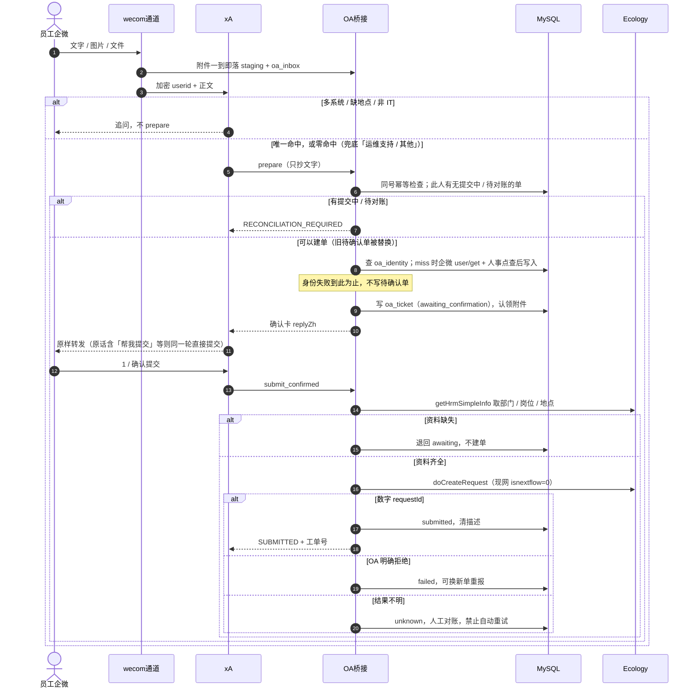

# xA 现网加固与演进全景

员工只走企业微信。SmartX 超融合上的一台 Linux 虚机用 Docker 跑一套 OpenClaw Gateway。Agent 只整理文字，唯一能调的工具是 `oa_workflow`。幂等、待确认单、身份缓存放在独立 MySQL。图片和文件不进模型，由插件暂存后写入泛微 Ecology 流程 602。

## 1. 架构

```text
员工企微 ──文字 / 图片 / 文件（群聊须 @）
    ▼
wecom 通道插件              加密 userid，无姓名 / 工号；附件落盘，不交给模型
    ▼
OpenClaw Gateway（单容器、单进程）
    ├── xA Agent            注入 AGENTS.md；只调 oa_workflow
    └── OA 桥接插件          5 个 action、附件暂存、身份转换（src/identity/，不是工具）
            ├─► 独立 MySQL   oa_ticket / oa_inbox / oa_identity
            ├─► 本机 staging 图片、文档字节；不进库、不进 prompt
            └─► Ecology 602  员工确认后才 doCreateRequest
```

## 2. 关键决策

| 决策 | 选择 | 不选 |
| --- | --- | --- |
| 宿主 | SmartX 划出的 Linux 虚机 + Docker | 员工工位、Windows；在 SmartX 控制台或宿主节点装 |
| 部署形态 | 一套 Compose 栈 + 一个目录 `~/xa` = 一个 Gateway | 容器里用 `openclaw --profile` 切多实例（`--profile` 是原生安装的多实例隔离，和 `tools.profile` 无关） |
| 同一 Bot 扩容 | 纵向：加 CPU / 内存 / 模型配额 | 复制容器（同一 Bot 只能一个 Gateway 持有，会抢连接、重复回复、打乱幂等） |
| 高可用 | 主备，同一时刻只有一个 Gateway 连 Bot | 双活 |
| 工单主路径 | `oa_workflow` → Ecology 602 | 企微智能表格、`wecom_mcp` |
| 状态 | 独立 MySQL 三张表，按主键 / 索引点查 | 本机文件台账、Redis（已下线） |
| 身份 | 桥接内身份转换 + `oa_identity` 缓存 | 手工映射文件；把加密 userid 当工号 |
| 模型 | 百炼兼容接口，catalog 仅 `text`，关思考链 | 多模态进 Agent |
| 工具 | `minimal` + 只放行 `oa_workflow` | `coding` / `full`；给模型 `read` |
| 凭据 | Compose secrets → entrypoint → `${VAR}` | json 明文；OpenClaw 直连配置中心 |
| 规则 | 会话开始注入 `AGENTS.md` | 热路径再 `read` 一堆 Markdown |

技术栈：Ubuntu 24.04；OpenClaw 2026.9.2（自建镜像 `xa-gateway-oa` = 官方镜像 + 桥接插件 + `mysql2` / `jpeg-js` / `pngjs`）；企微插件 `@wecom/wecom-openclaw-plugin` ≥ 2026.7.2；百炼 Provider `bailian`，超时 20 秒；MySQL 5.7+。

## 3. 部署

```text
SmartX 集群（平台运维：虚机规格、存储、网络、快照）
 └── Linux 虚机（本系统）
      └── ~/xa/
          ├── docker-compose.yml       image xa-gateway-oa，端口只绑 127.0.0.1:18789
          ├── entrypoint.sh            读 /run/secrets → export → gateway --bind lan
          ├── config/openclaw.json     → /home/node/.openclaw
          ├── workspace/               Agent 规则（AGENTS.md 等）
          ├── extensions/              企微插件（OA 插件在镜像 /opt/xa/oa-workflow-bridge）
          ├── oa-bridge-config.json    只读挂进插件目录（不含密码）
          └── secrets/*.txt            12 个凭据文件，600
```

- 工作区放虚机本机盘，不要 NFS / CIFS / 共享盘。
- 改 secret、插件路径、端口必须 `down && up`，环境变量不热更。
- MySQL 要先可连（插件加载即建表）。
- 三套凭据不能混：企微机器人 BotId/BotSecret（收发）、企微自建应用 corpid/secret（身份转换）、OA appid/AppSecret（建单）。

步骤见 [安装手册](OpenClaw%20Gateway%20Linux%20服务器安装手册.md)，日常见 [运维手册](OpenClaw%20Gateway%20Docker%20运维手册.md)。

## 4. 一条消息的全链路



`oa_workflow` 五个 action：

| action | 做什么 | 调 OA |
| --- | --- | --- |
| `prepare` | 生成待确认单（替换此人旧的待确认单），认领附件；未命中时兜底「运维支持 / 其他」；可带 `submitNow` 一步提交 | 否（身份 miss 时查企微 / 人事） |
| `attach` | 只收附件，不改状态 | 否 |
| `submit_confirmed` | 原发送人确认后建单 | 是 |
| `status` | 查此人当前待确认与最近记录 | 否 |
| `cancel` | 取消待确认单，删附件 | 否 |

业务规则要点（完整见 `workspace-rules/workspace/AGENTS.md` 与 [OA 接入手册](OA_tool/OA%20Workflow%20Bridge%20接入手册.md)）：

- 员工可见的成功只有 `SUBMITTED` + 数字 `requestId`。`OA_BRIDGE_INACTIVE` 不是成功。
- 同一人同时只有一张未结束的单（库层 `active_sender` 唯一约束）。报新问题会作废上一张待确认单。
- 「好的」「可以」不算确认。问地点用字母 A–F，数字只留给确认 / 取消。
- 多条规则命中时不猜；零条命中但确是 IT 的事，插件兜底建单。电脑 / 打印机 / 网络、邮箱、文件管理、MES 的地点必须问清，不默认园区。
- 待确认 24 小时过期；未进单的附件 30 分钟过期，`/new` 和群聊会话结束立即清。
- 现网 `isnextflow=0`：工单建出来但停在申请人节点，不自动流转。项目正式启用后改 `"1"`。

## 5. 门控

| 项 | 现网 |
| --- | --- |
| 放行工具 | 仅 `oa_workflow`（全局与 Agent 两处） |
| 禁止 | `read` / `write` / `edit` / `memory_*` / `message` / `wecom_mcp` / Codex |
| Skill | 两处 `skills: []`，挡住企微插件的 `wecomcli-*` |
| 附件 | 模型无 `read`，`tools.media` 全关，catalog 仅 `text`；单件 10MB、合计 25MB、最多 10 个 |
| 规则 | 只认注入的 `AGENTS.md`；`bootstrapMaxChars: 40000` 两处 |

字段解释见 [openclaw.json 配置参考.md](openclaw.json%20配置参考.md)。

## 6. 数据与身份

- `oa_ticket`：一张确认单一行，永久留台账。按插件生成的内部号 `IT-YYYYMMDD-HHMMSS-XXXX` 防止**同一张号**重复打 OA；进终态后清掉描述和附件清单。
- `oa_inbox`：每人一行，收到还没进单的附件。
- `oa_identity`：`mappingCode` = SHA-256(加密 userid) 前 24 位 → OA 人员 id；命中 24 小时，失败负缓存 10 分钟。原始 userid / 工号不落库、不打日志。
- 两条人事接口不要混：身份点查用 `getHrmUserInfoWithPage`（无 token，产出人员 id）；提交前资料用 `getHrmSimpleInfo`（token + RSA，产出部门 / 岗位 / 地点）。
- 模型只给类型、系统、描述（IT 需求另加需求类型、月节约工时）。申请人、部门、岗位、地点、处理人 `clry` 都由插件填。
- 两个 Gateway 连同一个库会双写 OA。

细节见 [OA 接入手册](OA_tool/OA%20Workflow%20Bridge%20接入手册.md) 与 [企微到OA身份.md](OA_tool/企微到OA身份.md)。

## 7. 性能

已做：

| 措施 | 效果 |
| --- | --- |
| 规则并入 `AGENTS.md`，热路径禁止 `read` | 去掉每轮十几次读文件和多余模型调用 |
| 两处 `skills: []` | 去掉约 1 万字符 Skill 目录 |
| 关闭媒体理解 | 发图少等约 7 秒 |
| 百炼 `compat.thinkingFormat: qwen` + 超时 20 秒 | 首包到回复从十几秒降到 2～5 秒；封住约 27 秒的空等 |
| 身份缓存、OA token 缓存约 25 分钟 | 命中时零外部 HTTP；建单通常只换一次 token |
| 提交时压图与取资料并行 | 缩短建单耗时 |
| 容器日志轮转 20m × 5 | stdout 不再涨盘 |

可继续：

| 方向 | 做 | 不要 |
| --- | --- | --- |
| 并发 | 百炼加 TPM / 并发；平台扩虚机 | 再起相同 Bot 的容器 |
| 磁盘 | inbound cron 删满 24 小时原件；盯会话 jsonl | 删台账、删 staging、`rm -rf workspace` |
| 外部依赖 | 保持身份缓存 | 给身份 HTTP 加自动重试；`unknown` 自动重提 |

## 8. 当前痛点

| 痛点 | 说明 |
| --- | --- |
| 不能水平扩同一 Bot | 进程内锁 + 企微单账号，忙了只能加机器 |
| 无热更新 | 改凭据、插件路径要重启 |
| secrets 是宿主机明文文件 | 靠 `600`；无集中审计、版本、灰度 |
| `AGENTS.md` 体积紧 | 已超默认 20000，再加内容可能被截断 |
| 身份 miss 依赖外部 | 企微通讯录 + 人事接口；回执码在会话 jsonl，不在 `docker logs` |
| 全局一张待确认偏硬 | 员工换对话后体验像卡住 |
| `unknown` 靠人工对账 | 见运维手册第 10 节 |
| 现网不自动流转 | `isnextflow` 为 `"0"`；正式启用改 `"1"` 并重启 |
| 配置分层坑 | `bootstrapMaxChars`、`skills` 只写 defaults 不生效 |
| compose 无内存闸 | 规格由 SmartX 虚机决定，容器限额不能代替扩虚机 |

## 9. 演进

**扩容与多业务**

| 目标 | 做法 |
| --- | --- |
| 同一个 IT 服务台人变多 | 不复制；平台扩虚机，百炼加配额 |
| 另一个机器人 / 业务线 / 测试环境 | 复制一套：新目录、容器名、宿主端口、secrets、企微 Bot、Gateway token、agent id。例：`~/xa-hr` 18790、`~/xa-staging` 18791（容器内仍 18789）。可共用 MySQL 服务器但必须不同库 |
| 同一企微通道多 Agent 路由 | 先验证企微插件多账号，再在**同一个** Gateway 里加 agent 和 bindings |
| 公司级生产 | 密钥进 Vault / 配置中心；主备切换流程化，备机预装镜像 |

**配置中心（Nacos）**：OpenClaw 不直连 Nacos，环境变量名不变，只换「谁给 secret 文件赋值」。

1. 先做：Nacos → 宿主机 sync 脚本写 `~/xa/secrets/*.txt`（一行、`600`）→ `down && up`。entrypoint 和 json 都不改；Nacos 宕机不影响已运行的容器。
2. 再考虑：entrypoint 启动时直拉 Nacos（强依赖配置中心可用性），或 OpenClaw `secrets.providers.exec` 解析器（只适合凭据类字段）。
3. 每套 `~/xa-*` 用独立 namespace / group，不共用 dataId。Nacos 访问凭据本身要单独注入。
4. 不进配置中心：工具白名单、bindings、`load.paths`、规则包、OA `active` 开关。

**接新的外部系统**：另做一个插件和工具名，不要塞进 `oa_workflow`。沿用 OA 桥接的形态：

- 固定 action，不做「模型传 URL / Header / Body」的通用 HTTP 工具；Schema `additionalProperties: false`。
- 域名、凭据、流程 ID、字段名、人员 id 都不由模型传；身份只认通道给的可信 `requesterSenderId`，群聊按实际发送人。
- 两阶段：`prepare` 不写外部系统，员工确认后才提交；员工可见文案由插件拼。
- 幂等：同号已提交拒绝；结果不明标 `unknown`，禁止自动重试。
- 凭据走 secret → 环境变量；日志不记 token、密文、附件 base64、身份原值。

## 10. 凭据边界

代码、配置结构、业务规则可以进仓库；以下不能进仓库、聊天或截图：企微 BotSecret、CorpSecret、OA AppSecret、模型 API Key、Gateway Token、私钥、原始 SenderId / 明文 userid / 手机号、真实工单正文和附件。

新环境的凭据一律重新申请，不复制旧值；旧值若暴露过必须轮换。测试只用脱敏数据和测试机器人。
