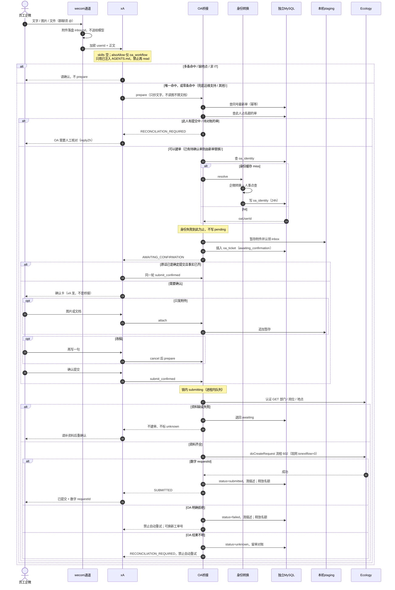
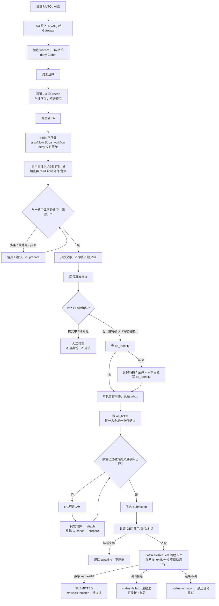

# xA 现网加固与演进全景

员工只走企业微信。SmartX 超融合上的 Linux 虚机里 Docker 跑一套 OpenClaw Gateway。Agent 只整理文字事实，唯一可调工具是 `oa_workflow`。幂等、待确认、身份缓存在独立机器上的 MySQL。图片和文件不进模型，由插件暂存后写入泛微 Ecology 流程 602。同一机器人不能横向复制当负载均衡；人变多只加机器和模型配额。再开一条业务线才起第二套 Gateway。

## 目录

- [1. 架构](#s1)
- [2. 选型](#s2)
- [3. 技术栈](#s3)
- [4. 部署](#s4)
  - [宿主（SmartX）](#s4-host)
- [5. 全链路](#s5)
  - [时序](#s5-seq)
  - [闸门](#s5-gate)
- [6. 门控（插件 / 工具 / Skill / 附件）](#s6)
- [7. 数据库、身份、OA 字段](#s7)
- [8. 性能](#s8)
  - [已做](#s8-done)
  - [可继续优化](#s8-next)
  - [纵向扩展](#s8-scale)
- [9. 当前痛点](#s9)
- [10. 演进](#s10)
- [11. 改配置前](#s11)

---

<a id="s1"></a>

## 1. 架构

运行时只有一层：员工企微 → 通道插件 → 单容器 Gateway。Gateway 里同时加载通道、Agent、OA 桥接（含身份转换）。身份转换不是单独容器，也不是模型可调工具。

```text
员工企微
    │  文字 / 图片 / 文件（群聊须 @）
    ▼
wecom 通道插件                    ← 加密 userid，无姓名/工号
    │  附件落盘 inbound；不送给模型
    ▼
OpenClaw Gateway（单容器、单进程）
    ├── xA Agent                ← 已注入 AGENTS.md；只调 oa_workflow
    ├── OA 桥接插件               ← 五 action、暂存附件、调 Ecology
    └── 身份转换（桥接内 src/identity/） ← 加密串 → OA 人员 id；不注册工具
            │
            ├─► 独立 MySQL        ← oa_ticket / oa_inbox / oa_identity
            ├─► 本机 staging      ← 图片、文档字节；不进库、不进 prompt
            └─► Ecology 流程 602  ← 仅确认后 doCreateRequest
```

一套业务的持久化全在 `~/xa`：`config`、`workspace`、`extensions`、`secrets`、`entrypoint.sh`。MySQL 在另一台机器上，Gateway 经局域网直连 3306（准备步骤见 [MySQL 数据库准备.md](MySQL%20数据库准备.md)）。

---

<a id="s2"></a>

## 2. 选型

xA 现网决策如下。Docker Compose vs `openclaw --profile`、多套目录怎么扩，见 [OpenClaw Gateway 部署拓扑与选型.md](OpenClaw%20Gateway%20部署拓扑与选型.md)。

| 决策 | 选择 | 不选 |
| --- | --- | --- |
| 宿主 | SmartX 超融合 Linux 虚机 + Docker | 员工工位；Windows 原生 DPAPI；在 SmartX 控制台或宿主机节点上装 Gateway |
| 同一 Bot 扩容 | 纵向：CPU / 内存 / 模型配额 | 再起一个相同 Bot 的容器（会抢连接、重复回复、打乱幂等） |
| 高可用 | 主备，同一时刻只连一个 Gateway | 双活 |
| 工单主路径 | `oa_workflow` → Ecology 602 | 企微智能表格、`wecom_mcp` |
| 状态与幂等 | 独立 MySQL（三张表，按单号 / 人点查） | 本机 `ticket-ledger.md`；文件版 `state.json`；Redis（已下线） |
| 身份 | MySQL `oa_identity` 缓存 + 桥接内身份转换 | 手工映射文件；把加密 userid 当工号 |
| 模型 | 阿里云百炼兼容接口，catalog 仅 `text` | 多模态进 Agent；打开思考链 |
| 工具策略 | `minimal` + 只放行 `oa_workflow` | `coding` / `full`；给模型 `read` |
| 凭据 | Compose secrets → entrypoint → `${VAR}` | json 明文 Key；OpenClaw 直连配置中心 |
| 规则 | 会话开始注入 `AGENTS.md` | 热路径再 `read` 一堆 Markdown |

---

<a id="s3"></a>

## 3. 技术栈

| 层 | 现网 |
| --- | --- |
| 宿主 | SmartX 超融合上的 Linux 虚机（Ubuntu 24.04） |
| 编排 | Docker Compose；现网钉 `ghcr.io/openclaw/openclaw:2026.9.2`（见仓库 `docker/docker-compose.yml`）。安装手册初装可用 Hub `openclaw/openclaw:latest` |
| 运行时 | OpenClaw 2026.9.2；`agents.entries`（不用旧的 `list`） |
| 通道 | `wecom-openclaw-plugin`（WebSocket 收发）；同一 BotId 只能一个 Gateway 持有 |
| Agent | `itservicedeskagent`；`thinkingDefault: off` |
| 模型 | Provider `bailian`；`timeoutSeconds: 20`；catalog `compat.thinkingFormat: qwen`（不是 Agent 字段） |
| 通道占位 | `channels.wecom.sendThinkingMessage: true`（插件须 ≥ 2026.7.2；与百炼思考链不是一事） |
| 工单 | `oa-workflow-bridge`；`active=true` 才真正建单。现网 `isnextflow=0`：创建成功但不自动流转，停在申请人节点；项目可用后改回 `1` |
| 身份 | 桥接 `src/identity/`；`bridge-config.json` 的 `identity.adapter=on` |
| 存储 | MySQL 独立实例；`oa_ticket` / `oa_inbox` / `oa_identity`，按主键 / 索引点查 |
| 锁 | Gateway **进程内队列**；「同一人一张待确认」另有库层唯一约束兜底 |
| OA | `applytoken` → 认证 `getHrmSimpleInfo` → `doCreateRequest`；token 进程内缓存约 25 分钟 |
| 附件 | 本机 staging；图片压缩嵌富文本，文档走 `scfj` |
| npm | 镜像内给桥接装 `mysql2`、`jpeg-js`、`pngjs`。备份恢复后须重装 |

三套凭据不能混：企微机器人 BotId/BotSecret、自建应用 corpid/corpsecret（身份转换）、OA appid/AppSecret。

四种身份不能混：appid（哪个应用）、AppSecret（换 token）、接口账号人员 id（只读预检）、**申请人人员 id**（建单 Header 与表单，必须是聊天员工）。

---

<a id="s4"></a>

## 4. 部署

```text
Linux 虚机（SmartX 划出）
└── ~/xa/
    ├── docker-compose.yml        → image xa-gateway-oa（官方 OpenClaw + OA 桥接插件与依赖）
    ├── config/openclaw.json      → 容器 /home/node/.openclaw
    ├── workspace/                → Agent 规则（AGENTS.md 等）
    ├── extensions/               → 企微通道插件（OA 插件在镜像 /opt/xa/oa-workflow-bridge）
    ├── oa-bridge-config.json     → 只读挂到插件目录的 bridge-config.json（不含密码）
    ├── secrets/*.txt             → /run/secrets/（chmod 600）
    └── entrypoint.sh             → export 后 exec gateway --bind lan --port 18789
```

工作区放这台虚机的 Linux 本机家目录，不要 NFS / CIFS，也不要放到超融合下发的共享盘。

<a id="s4-host"></a>

### 宿主（SmartX）

现网机器是 SmartX 超融合划出的 **Linux 虚机**，不是集群本身。xA 只跑在这台虚机里面。

```text
SmartX 集群（平台运维）
 └── Linux 虚机                 ← 本系统的「宿主机」
      ├── Docker Engine
      └── ~/xa/
```

| 谁 | 管什么 |
| --- | --- |
| 平台运维（SmartX） | 虚机规格（CPU / 内存 / 磁盘）、存储、VLAN / 出网、快照 |
| 本系统 | 虚机内的 Linux、Docker、`~/xa`、Gateway、插件与 secrets；独立 MySQL 机器上的库与账号 |

不要把 Gateway 装进 SmartX 控制台或宿主机节点。出网（拉镜像、百炼、企微、OA）和入站端口由平台网络策略决定；18789 不要对公网开放。虚机规格不够找平台扩，不要用 compose `mem_limit` 代替加内存。

注入链：宿主机 secret 文件 → Compose secrets → entrypoint `export` 大写变量 → json 只写 `${OPENCLAW_GATEWAY_TOKEN}`、`${XA_DOMESTIC_*}` 等。改 secret、插件路径、bind、端口必须 `compose down && up`，env 不热更。

Docker 必须 `gateway.bind: lan`。容器若只听 `loopback`，宿主机端口映射进不来。

`openclaw.json` 现网要点：

- `plugins.allow`：企微通道、OA 桥接。`plugins.deny` 含 `codex`，且 `entries.codex.enabled: false`
- 身份转换已并入桥接，没有单独插件；开关在桥接 `bridge-config.json` 的 `identity.adapter`
- `tools.profile: minimal`；全局与 Agent 两处 `alsoAllow` 均仅 `oa_workflow`
- Agent `deny` 含 `group:fs` / runtime / ui / web / automation
- `tools.media.image/audio/video.enabled` 全 `false`；不设 `imageModel`
- `skipBootstrap: true`；`bootstrapMaxChars: 40000` 与 `skills: []` 必须写在 **defaults 和 `itservicedeskagent` 两处**
- 百炼 catalog 写 `compat.thinkingFormat: qwen`；`channels.wecom.sendThinkingMessage: true`
- 改完 `config validate`，重启 Gateway，企微里 `/new` 后再 `/context detail`

MySQL 需先可连（Gateway 启动时建表）。缺 `jpeg-js` 则桥接整包加载失败。缺 `mysql2` 包则 `prepare` 失败，不要先当 OA 接口故障。

---

<a id="s5"></a>

## 5. 全链路

时序看谁在何时调用谁。闸门看哪一步可以停。身份失败时连 pending 都不写；其后任一闸门失败都不得 `doCreateRequest`。

<a id="s5-seq"></a>

### 时序

启停先于任何员工消息：独立 MySQL 可连 → `~/xa` 注入 `${VAR}` 起 Gateway → 加载 wecom 与 OA 桥接、deny Codex。下面从第一条企微消息画到建单回执。



<a id="s5-gate"></a>

### 闸门



`oa_workflow` 五个 action：

| action | 做什么 | 调 OA |
| --- | --- | --- |
| `prepare` | 生成一次性确认单；写 oa_ticket；自动认领本轮与 inbox 附件；规则未命中时兜底运维支持 / 其他 | 否（身份 miss 时查企微/人事） |
| `attach` | 补图/补文档，不改工单状态；跨会话禁止 | 否 |
| `submit_confirmed` | 原发送人确认后建单；跨会话可确认，不并入新会话附件 | 是 |
| `status` | 按人或按确认号点查 | 否 |
| `cancel` | 取消待确认单，删其附件 | 否 |

员工可见成功口径：只有回执 `SUBMITTED` 且含**数字** `requestId`。`OA_BRIDGE_INACTIVE` 不是成功，不得改走智能表格。OA 明确拒绝记 `failed`，并 **DEL pending**（可换新工单号再 prepare，同一确认号不能再交）；结果不明记 `unknown`（pending 留对账态）。两者都禁止自动重试。

现网 `doCreateRequest` 带 `isnextflow=0`：流程 602 会建出来，但停在申请人节点、不自动推到处理人。这是生产测试开关，不是草稿；项目可用后改回 `1`。

员工看到的回复由插件拼好（回执 `replyZh`），模型原样转发；AGENTS.md 只保留判断规则和几句追问。确认规则：原话含「帮我提交 / 立刻提交」等且事实已齐，`prepare` 带 `submitNow`，一次建单并提交。不要把「好的」「可以」当提交。无该口吻则出确认卡（回复 1 确认 / 2 取消）。问地点用字母 A–F，数字只留给确认 / 取消。

同一人同时只有一张待确认。再报新问题时插件作废上一张、按新问题建单（同一对话里是改稿，旧单附件带过来；另一个对话里旧单附件随之清除）。另一个对话里也能查到、确认或取消上一张。待确认 24 小时未处理按 `expiresAt` 清除。附件一收到就落库；还没进单的附件 30 分钟不动即过期，`/new` 与群聊 `session_end` 立刻清。

多条规则命中：不猜系统、不 `prepare`。零条命中但确实是 IT 的事：不追问，插件兜底为「运维支持 / 其他」（类型已命中则「该类型 / 其他」）。地点未说明时，电脑/打印机/网络以及国内/越南邮箱、文件管理、MES B/C 必须问清，禁止默认园区。

---

<a id="s6"></a>

## 6. 门控（插件 / 工具 / Skill / 附件）

三层不要混。

```text
插件能否加载          plugins.allow / deny / load.paths
    ├── 通道 wecom        不走工具白名单
    ├── 工具 oa_workflow  还要写入 alsoAllow 模型才能调
    ├── Skill 目录        走 agents.*.skills；现网 []，不进 prompt
    └── 身份转换          桥接内部模块，不注册工具
```

| 项 | 现网 |
| --- | --- |
| 放行工具 | 仅 `oa_workflow` |
| 明确禁止 | `read` / `write` / `edit` / `memory_*` / `message` / `wecom_mcp` / Codex |
| Skill | `skills: []` 写两处。现网 json **不写** `skills.entries`。只把 `entries.*.enabled: false` 当全关是错的：挡不住企微插件的 `wecomcli-*` |
| 附件 | 模型没有 `read`；`tools.media` 全关；catalog 仅 `text`。插件按路径暂存，不刮完整 prompt。员工只看到「已收到 N 份图片/文档」 |
| 规则 | 运行时只认已注入的 `AGENTS.md`。人编映射表改完必须同步进去，热路径禁止再读 |

去掉 `wecom_mcp` 只关掉智能表格工具，**不会**关企微收发。限额：单文件 10MB、合计 25MB、最多 10 个（`attach` / `prepare` 当时校验）。图片进问题描述富文本，文档进 `scfj`；未配附件字段却带文档在 **`submit_confirmed`** 拒绝，不是 prepare。base64 不进库、不进模型。

`skipBootstrap: true` 禁止运行时重生官方空规则；不会停止注入已有 `AGENTS.md`。不要设 `contextInjection: never`，否则规则整包不进模型。

---

<a id="s7"></a>

## 7. 数据库、身份、OA 字段

三张表、状态机、回收见 [OA_tool/OA Workflow Bridge 接入手册.md](OA_tool/OA%20Workflow%20Bridge%20接入手册.md) 第 2 节。

记住四条：`oa_ticket` 一张确认单一行、永久留台账（按内部工单号幂等，不是冷却）；`active_sender` 唯一约束保证同一人全局一张待确认；`oa_identity` 只缓存身份；`SUBMITTED` / 取消 / 过期后清掉描述与附件清单，只留单号和状态。两个 Gateway 连同一个库会双写 OA。

台账按插件生成的 `IT-YYYYMMDD-HHMMSS-XXXX` 点查，永久留下。它防的是**同一张号**再打 Ecology：模型幻觉多调一次确认、员工说「再提交」但复用旧确认号、`unknown` 后又拿同一号 prepare。拦不住「下一句开一张新号」——那要靠规则不要乱 prepare；同人同时只能有一张待确认靠 `active_sender`（企微把正文和附件拆成两条时，两轮会各生成一个号，只查同号不够）。不要理解成「刚交完短时间不能再交」。

身份查找键是 `mappingCode` = SHA-256(加密 SenderId) 截前 24 位，不是工号、不是姓名。命中：0 次外部 HTTP。Miss：`user/get`（回退 `openuserid_to_userid`）→ 明文 userid 对齐 OA `workcode` → `getHrmUserInfoWithPage` → 写入 `oa_identity`。原始 userid / 工号不落库、不打日志、不回给员工。

两条人事 HTTP 不要混：

| | 身份点查（prepare miss） | 提交前资料（submit） |
| --- | --- | --- |
| 谁 | 身份转换（`src/identity/`） | 桥接提交 |
| 接口 | `getHrmUserInfoWithPage` | `getHrmSimpleInfo` |
| 认证 | 无 token | 与建单同一套：token + appid + RSA(申请人) |
| 产出 | 数字人员 id | 部门 / 岗位 / 地点 |
| 失败 | 不写 pending | 退回 awaiting，不建单、不标 unknown |

建单时模型只给类型、系统、摘要、文字描述（IT 需求另加需求类型与月节约工时）。插件注入申请人、部门、岗位、地点、处理人 `clry`（按所属系统配置，模型不传人员 id）。xA 内部工单号由插件按 Asia/Bangkok 墙钟生成 `IT-YYYYMMDD-HHMMSS-XXXX`，模型传入的一律忽略；只作幂等键和流程标题前缀，不写入问题描述，也不展示给员工。现网建单 `otherParams.isnextflow` 取自 `bridge-config.json`（样例 `"0"`）。

---

<a id="s8"></a>

## 8. 性能

<a id="s8-done"></a>

### 已做

| 措施 | 作用 |
| --- | --- |
| 规则并入 `AGENTS.md`，热路径禁止 `read` | 去掉每轮十几次读文件 + 多次 model-fetch |
| `skills: []` 写两处 | 去掉约 1 万字符 Skill 目录 |
| `bootstrapMaxChars: 40000` 写两处 | 默认 20000 会截断禁令后半段 |
| 关闭 media 理解 | 发图曾多 7.2s 的 `apply_media_understanding` |
| 思考链关闭 + 超时 20s | 曾出现 `timeoutMs=undefined` 空等约 27s |
| 身份缓存命中 | 0 次外部 HTTP |
| token 缓存约 25 分钟 | 资料现查与建单通常只换一次 token |
| 附件不进 prompt | 不把路径和 base64 喂给模型 |
| Gateway `logging`：`json-file`、`max-size: 20m`、`max-file: 5` | 容器 stdout 不再无限涨盘（不管会话 jsonl / inbound） |

改 `skills` / `bootstrapMaxChars` 后必须重启再 `/new`。旧会话会缓存截断结果。验收：`/context detail` 中 `AGENTS.md` 未被截断，`Skills list` 为 0；发图日志无媒体理解。

<a id="s8-next"></a>

### 可继续优化

热路径上 Gateway 侧该关的已经关了。剩下的瓶颈不在再改 `openclaw.json` 白名单。

| 方向 | 现网事实 | 做 | 不要 |
| --- | --- | --- | --- |
| 模型配额 | 同一 Bot 只能一个 Gateway；进程内队列把确认串成一条 | 百炼控制台加 TPM / 并发 | 再起一个相同 Bot 当负载均衡 |
| 数据库 | 业务已是按主键 / 索引点查。`oa_ticket` 永久留台账（月约百行），缓存表定时清 | 按普通业务库备份 | 手删 `oa_ticket` 历史行；多个 Gateway 连同一个库 |
| 身份 miss | 命中 0 次外部 HTTP。miss 最多 `user/get`（回退转换，超时 **20s**）+ `getHrmUserInfoWithPage`（超时 **30s**），无重试，负缓存 10 分钟 | 保持身份缓存；凭据注入一次到位 | 给身份 HTTP 加自动重试；把加密 userid 当工号 |
| 建单长尾 | `submit_confirmed` 已并行：压图 + `getHrmSimpleInfo`；随后 `doCreateRequest` 超时 30s | 接受 Ecology 侧耗时；token 缓存约 25 分钟通常只换一次 | 失败后自动再 `submit_confirmed`（`unknown` / `failed` 都禁止） |
| 附件转码 | 图片纯 JS 压到长边 1280、目标 ≤400KB；文档 submit 时读盘转 base64。都不进模型、不进库 | 大文档就是上游长尾；限额已是 10MB / 25MB / 10 个 | 打开 `read` 或 `imageModel`「让模型看一眼」 |
| 磁盘 | 容器日志已轮转（20m × 5）。会话 jsonl 仍留盘。inbound 原件在两处：`config/media/inbound` 与 `workspace/media/inbound`（桥接两处都可拷进 staging），插件提交后都不删 | 宿主机 cron 对这两处满 24 小时删除（`-mmin +1440`）；盯 jsonl；工作区放 Linux 本机盘 | 数据放 NFS/CIFS；为清盘去删台账；`rm -rf workspace`；对未满 24 小时的原件手删；手删 `oa-workflow-bridge/staging/` |

群聊 `idleMinutes: 30` 已经在 json 里，会触发 `session_end` 清未 prepare 的 inbox，不是待做项。

<a id="s8-scale"></a>

### 纵向扩展

同一 Bot、同一 `~/xa`：找平台给这台 SmartX 虚机加 CPU、内存、磁盘，给百炼加模型配额。compose 当前无 `mem_limit`（那是容器限额，不是虚机规格）；加限额后若 OOM，先查日志和会话是否把盘打满。

横向复制只用于**另一条业务 / 另一个机器人**。

---

<a id="s9"></a>

## 9. 当前痛点

| 痛点 | 说明 |
| --- | --- |
| 不能水平扩同一 Bot | 单进程锁 + 企微单账号。忙了只能加机器，不能多活 |
| 无真正热更新 | 改凭据、插件路径必须重启。多实例各维护一份 `secrets/` |
| secrets 仍是宿主机明文文件 | 靠 chmod 600；无集中审计、灰度、版本 |
| OpenClaw 配置分层坑 | `bootstrapMaxChars`、`skills` 只写 defaults 对已绑定 Agent 不生效 |
| `AGENTS.md` 体积紧 | 已超默认 20000；再往里塞完整模板会再次截断 |
| 身份 miss 有外部依赖 | 企微通讯录 + 人事接口；凭据未注入时码在会话 jsonl，不在 `docker logs` |
| 两条人事接口易混 | 点查人员 id 与提交前资料认证、产出都不同 |
| 加密 userid | 现网 `wo…` 不能当工号或申请人 |
| 全局待确认偏硬 | 员工 `/new` 后不能补件、不能开新单，体验上像卡住 |
| Gateway 重启丢内存缓冲 | 库里的待确认还在；未写入 inbox 的 inbound 可能丢 |
| `unknown` 不能自动重试 | 对账靠人，步骤见运维手册 **12.5**；明确拒绝是 `failed`（pending 已清），可换新工单号，不要当成同一回事 |
| 现网不自动流转 | `bridge-config.json` 的 `isnextflow` 为 `"0"`，单据停在申请人；测试结束改成 `"1"` 并重启 Gateway。专项手册按现网写 `"0"`，并标明目标口径 `"1"` |
| 备份恢复易漏 npm | 排除 `node_modules` 后必须在镜像内重装，否则整包或 prepare 失败 |
| 插件 skill 会偷跑进 prompt | 未写 `skills: []` 时 `wecomcli-*` 仍出现 |
| 智能表格旁路 | 旧 `alsoAllow` 或旧规则会再打 `smartsheet_get_records` |
| 思考占位与思考链是两件事 | 现网占位 `sendThinkingMessage: true`；动画不消失立刻改回 `false`。思考链靠 catalog `thinkingFormat: qwen` + `thinkingDefault: off` |
| compose 缺内存闸 | 无 `mem_limit`。会话 jsonl 与 inbound 仍会涨盘（容器日志已轮转） |
| 规格在平台侧 | CPU / 内存 / 磁盘由 SmartX 虚机决定；容器限额不能代替扩虚机 |

---

<a id="s10"></a>

## 10. 演进

**配置中心迁 Nacos。** OpenClaw 不直连 Nacos。取数层把平台配置转成现有环境变量名，json 仍全是 `${VAR}`。推荐先做：Nacos → sync 脚本写 `secrets/*.txt` → 现有 entrypoint 不变 → `down/up`。entrypoint 启动时直拉 Nacos 是下一步，强依赖配置中心可用性。工具白名单、规则包、`load.paths`、bindings、`active` 不进配置中心。多套 `~/xa-*` 用独立 group，禁止共用 dataId。

**多业务扩展。** 复制 compose 并全部换新：目录、容器名、宿主端口、secrets、企微 Bot、Gateway token、agent id。示例：

```text
~/xa/          IT 服务台，宿主 18789
~/xa-hr/       另一业务，宿主 18790
~/xa-staging/  测试机器人，宿主 18791
```

容器内端口仍是 18789。可共用一台 MySQL，但必须不同库（不同 `mysql.database`）。同一通道多 Agent 路由：先验证企微插件多账号，再在**同一个** Gateway 的 json 里加 agent 和 bindings，不要为此再起容器。

其它：

- 密钥进 Vault 或 Nacos
- 主备切换流程化；备机预装镜像和插件依赖
- 新外部系统另做工具名，加入白名单，不要塞进 `oa_workflow`
- 观测把 `/context detail`、`timeoutMs`、`oa_ticket` 中 `unknown` 条数、`docker stats` 收进巡检
- compose 可选 `mem_limit`（先看 `docker stats` 再设）

---

<a id="s11"></a>

## 11. 改配置前

| 想做 | 正确做法 | 错误做法 |
| --- | --- | --- |
| 关 Codex | `plugins.deny` + `entries.codex.enabled: false` | 只从 allow 里删掉 |
| 关 Skill 目录 | 两处 `skills: []`，重启 + `/new` | 只点名 bundled 为 false |
| 只让模型建单 | 两处 `alsoAllow: ["oa_workflow"]` | 加回 `read` 方便看图 |
| 关掉企微 | 关通道 / 插件 enabled | 去掉 `wecom_mcp` |
| 暂停建单 | `bridge-config.json` 的 `active=false` | 移出 `oa_workflow`；改走表格 |
| 恢复 OA 自动流转 | `bridge-config.json` 的 `isnextflow` 改成 `"1"`，重启 Gateway，并同步专项手册 | 改 `mapping.mjs`；只改文档、不改配置 |
| 扩用户量 | 平台扩 SmartX 虚机 + 加模型配额 | 复制同一 Bot；在 SmartX 控制台再装一套 Gateway |
| 扩新业务 | 新目录 + 新 Bot + 新端口 | 同一容器 `--profile` |
| 迁配置中心 | Nacos → 现有 `${VAR}` | OpenClaw 直连 Nacos、改变量名 |

验收最小集：配置校验通过；`Skills list` 为 0 且规则未被截断；发图无媒体理解、模型不根据截图编描述；确认后拿到数字 `requestId`；同一人第二会话报新问题只能先处理上一张。
